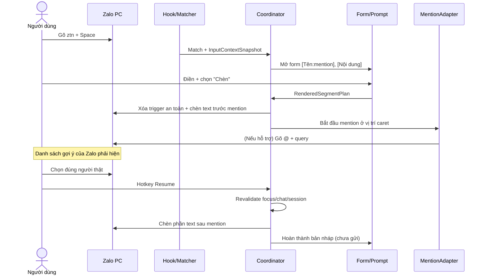

# ZaloSnippet — Full Product & Technical Specification v1.1 — Mention Engine

**Ngày:** 2026-11-11  
**Trạng thái:** Đặc tả để triển khai (chưa phải sản phẩm đã thử nghiệm)  
**Nền tảng:** Windows 10/11 x64  
**Ngôn ngữ:** Rust 2024 Edition  
**Đối tượng:** Nhân viên hỗ trợ khách hàng / IT Helpdesk dùng Zalo PC; cũng có thể dùng với những ứng dụng Windows tương thích.  
**Mục tiêu:** Công cụ text expander offline bằng Rust, hotstring tương tự AutoHotkey, thư viện mẫu không giới hạn cứng, form biến động và **mention (`@tag`) thành viên Zalo thật thông qua thao tác chọn thành viên ngay trên Zalo PC**. Không phụ thuộc hạn mức Tin nhắn nhanh của Zalo.

> **[Unverified] Trạng thái:** Đây là đặc tả THIẾT KẾ, chưa có thử nghiệm thực tế trên phiên bản Zalo PC đích. **Không thể xác minh Zalo PC có expose đủ UI Automation tree hoặc cho phép điều khiển mention tự động.** Tính năng tag thực chỉ được công nhận khi thành viên được chọn trong danh sách của Zalo và qua kiểm thử thực tế. Mọi yêu cầu, KPI, cấu hình, kiến trúc và lựa chọn thiết kế dưới đây là **đề xuất cho sản phẩm cần xây dựng**, không phải tính năng đã được kiểm chứng trên Zalo PC. Khả năng thay thế văn bản trực tiếp, ngắt dòng và phát hiện vùng nhập phải qua kiểm thử thực tế trên phiên bản Zalo được triển khai.

---

## 1. Tóm tắt và phạm vi

### 1.1. Tính năng bắt buộc

1. Chạy nền trên Windows, hiện ở **system tray**; mở UI quản lý khi cần.
2. Nhận diện hotstring khi người dùng gõ tại vùng nhập được cho phép.
3. Hỗ trợ cú pháp import:
   ```text
   ::trigger::
   (
   Nội dung tiếng Việt nhiều dòng; chứa [Biến]
   )
   return
   ```
4. Gõ `ztn` rồi `Space` → nhận diện `::ztn::`. Mặc định không dùng Enter làm phím kích hoạt, tránh gửi tin nhắn trong Zalo. Cho phép tùy chọn phím `Tab`, hoặc dạng literal `::ztn::`.
5. Nội dung không có biến: thay thế nhanh trực tiếp trong ô nhập. Nội dung có biến: mở popup nhập các trường, hiển thị live preview rồi mới chèn.
6. Hỗ trợ nhiều mẫu, tìm kiếm, nhóm, tag, favourite, enable/disable, import/export, backup, restore.
7. Thêm vào vùng nhập bằng Unicode có hỗ trợ tiếng Việt và ký tự xuống dòng; **không tự nhấn Enter để gửi**.
8. Không gửi nội dung đã gõ ra Internet, không yêu cầu tài khoản hoặc backend.
9. Có danh sách ứng dụng cho phép, mặc định user cấu hình Zalo thông qua trình chọn process/window; không hardcode tên executable chưa xác minh.
10. Có phương án **Copy only** khi ứng dụng không cho phép chèn tự động.

### 1.2. Không nằm trong v1.0

- Đọc/gửi tin nhắn Zalo API, bot hoặc tự gửi hàng loạt; tự động bấm Send.
- Kết nối API nội bộ/không công khai của Zalo, reverse engineering protocol, lấy ID tài khoản Zalo, đọc danh sách thành viên toàn nhóm mà không có tương tác người dùng.
- Khẳng định đã gửi notification mention chỉ dựa trên chuỗi `@Tên` trong text.
- Trích xuất người nhận, tên người nhắn hoặc nội dung cuộc trò chuyện từ Zalo.
- Tự động đọc toàn bộ văn bản trên màn hình, OCR, AI rewrite, đồng bộ tài khoản/cloud.
- Tích hợp doanh nghiệp/phân quyền theo server; bản mobile/macOS.

### 1.3. Nguyên tắc an toàn

- **No autosend:** phần mềm chỉ chuẩn bị/chèn bản nháp.
- **No full key logging:** giữ tối đa cửa sổ ký tự gần nhất trong bộ nhớ volatile; không lưu lịch sử phím hoặc văn bản người dùng nhập.
- **Safe fallback:** không đủ điều kiện xác định ô nhập → chỉ sao chép bản nháp và hướng dẫn dán thủ công.
- Chỉ xử lý khi cửa sổ foreground thuộc app allowlist và input control được đánh giá phù hợp; tắt xử lý trong password/secure desktop nếu xác định được. Do không phải mọi ứng dụng đều expose UI Automation, mặc định **fail closed** khi không xác minh được vùng nhập; cho phép bật chế độ compatibility sau cảnh báo rủi ro.
- Không yêu cầu Administrator. Không cố bypass Windows User Interface Privilege Isolation (UIPI) hoặc UAC.

---

## 2. User stories và tiêu chí hoàn thành

| ID | User story | Acceptance criteria |
|---|---|---|
| US-01 | Tôi gõ `ztn` rồi Space tại Zalo | Hệ thống tìm đúng mẫu và mở form 2 trường `Tên`, `Nội dung` |
| US-02 | Tôi điền các biến khác nhau | Những vị trí dùng cùng tên biến thay đổi đồng bộ trong preview |
| US-03 | Tôi chọn Chèn vào Zalo | Nội dung được chèn vào đúng vùng soạn thảo; không phát lệnh gửi |
| US-04 | Tôi không muốn dùng form | Snippet không có biến được chèn trực tiếp |
| US-05 | Tôi muốn tạo 100+ mẫu | Có thể lưu và tìm kiếm mẫu; không có giới hạn cố định kiểu 3 mẫu |
| US-06 | Tôi muốn tạm ngưng | Tray menu Pause/Resume có hiệu lực tức thì |
| US-07 | Tôi dùng tiếng Việt, nhiều dòng | Không mất dấu, không gộp dòng ngoài chủ ý |
| US-08 | Tôi cần đưa mẫu sang máy khác | Import/export dạng `.zsnip`, JSON và file legacy `.ahk.txt` |
| US-09 | Tôi dùng app khác | Chỉ kích hoạt khi được phép; có thể chọn app theo đường dẫn thực thi |
| US-10 | Dán tự động không được | Có thông báo phù hợp và nút Copy-only |
| US-11 | Tôi đóng cửa sổ cấu hình | Engine vẫn chạy ở system tray |
| US-12 | Tôi khởi động lại Windows | Tự chạy nếu đã bật Start with Windows; dữ liệu vẫn còn |
| US-13 | Tôi cấu hình `[Tên]` là mention | Form cho chọn text/mention và hiển thị kết quả dự kiến rõ ràng |
| US-14 | Tôi muốn tag thành viên cụ thể trong nhóm Zalo | App điều phối việc mở bộ gợi ý @; người dùng xác nhận đúng thành viên trên Zalo |
| US-15 | Có hai thành viên trùng tên | Không tự chọn đại, bắt buộc xác nhận tay |
| US-16 | Có nhiều mention trong một mẫu | Chèn theo thứ tự, dừng chờ xác nhận từng mention, giữ phần trước/sau |
| US-17 | Zalo thay đổi UI hoặc danh sách không hiện | Dừng an toàn, không nhầm tag, chuyển sang chế độ hỗ trợ thủ công |
| US-18 | Tôi chuyển chat giữa chừng | Không tự chèn phần còn lại vào chat khác; thông báo bản nháp đang dở |

---

## 3. Hành vi hotstring

### 3.1. Hai lớp ký pháp

- **Khai báo** `::ztn::` là metadata trong file cấu hình. `ztn` là trigger code.
- **Runtime mặc định:** gõ `ztn` + `Space` tại vùng được cho phép, và đúng ranh giới từ (trước trigger là đầu văn bản hoặc ký tự phân cách).
- **Tùy chọn:** dùng `Tab` làm delimiter; bật hotstring instant cho code có tiền tố rõ ràng như `;ztn`; hoặc literal-trigger mode gõ đúng `::ztn::` và lập tức kích hoạt.
- **Tuyệt đối:** Enter không là delimiter mặc định, đặc biệt khi đang soạn chat.
- Case-sensitive: `false` mặc định; mã `ZTN` và `ztn` tương đương nếu bật insensitive.
- Chống kích hoạt trong từ dài: `abc_ztn` không match khi chưa đến word boundary.
- Trùng trigger trong cùng phạm vi: lỗi validation; không tự lấy mẫu đầu tiên.
- Nếu có mẫu `z` và `ztn`, chỉ match khi delimiter hoặc có cơ chế xác định kích hoạt rõ ràng.
- `Ctrl` / `Alt` / `Win` shortcut không được tính là ký tự gõ; reset trạng thái khi app focus đổi hoặc khi người dùng di chuyển con trỏ/selection.
- Khi IME đang composition: không nhận diện đến khi kết thúc composition; nếu không xác minh được trạng thái IME ở ứng dụng tương ứng, không tự thay thế, dùng global snippet palette thay thế.
- Dùng `LLKHF_INJECTED` và extra-info marker để tránh vòng lặp từ phím do engine tự phát; lưu ý phím của các bộ gõ tiếng Việt cũng có thể là injected, nên không được coi *mọi* injected event là sự kiện của engine. Xử lý bằng marker riêng và test UniKey/EVKey/Windows IME.

### 3.2. Quy trình thực thi an toàn

**Nhánh A: snippet tĩnh, không có placeholder**

1. Keyboard hook nhận ký tự và delimiter, đối chiếu memory trie/buffer.
2. Khi match, chặn **delimiter** (Space/Tab) nếu engine xác định sẽ xử lý.
3. Xác thực foreground app và input context, snapshot `HWND`, PID, thread/focus identity, trigger/delimiter.
4. Nếu context không xác định/không an toàn: khôi phục delimiter bị chặn nếu phù hợp; không xóa chữ đã gõ; báo non-intrusive, hoặc copy-only nếu người dùng yêu cầu.
5. Nếu context hợp lệ: xóa số ký tự trigger đã hiện trong input theo chính xác số lần edit cần thực hiện; không dựa mù vào số byte UTF-8; mặc định trigger ASCII nên số ký tự bằng số Backspace.
6. Dán bản nháp bằng phương thức đã cấu hình. Không đưa Space bị chặn vào cuối nội dung trừ khi tùy chọn `preserve_delimiter=true`.
7. Ghi trạng thái `success` khi thao tác input đã được OS chấp nhận; **không khẳng định ứng dụng đã hiển thị đúng** nếu chưa thể xác minh bằng UI Automation. Có cách Undo và Copy-only.

**Nhánh B: snippet có placeholder**

1. Hook phát hiện trigger và chặn delimiter, snapshot ngữ cảnh gốc.
2. Mở popup **nhập biến**, vẫn giữ trigger trong ô chat đến lúc người dùng xác nhận. Đây là nguyên tắc hai pha để tránh xóa nhầm dữ liệu khi Cancel.
3. Nếu Cancel: đóng popup, để lại đúng trigger đã gõ; không gửi hay thay thế nội dung.
4. Nếu xác nhận: kiểm tra lại foreground app, input identity và context/selection. Chỉ nếu còn đủ điều kiện mới xóa trigger và chèn bản nháp.
5. Khi không thể phục hồi focus hoặc xác nhận vị trí con trỏ, **không gửi Backspace mù**: cung cấp `Copy` và hướng dẫn người dùng quay lại ô nhập, chọn/xóa trigger trước khi dán; hoặc áp dụng cơ chế xác nhận riêng nếu UI Automation hỗ trợ.
6. Nếu người dùng chuyển sang cuộc trò chuyện khác trong lúc popup mở: tuyệt đối không tự chèn nhầm người nhận. Hiển thị cảnh báo `Vùng nhập đã thay đổi` và chuyển sang copy-only.
7. Luôn tạo bản preview trước chèn. Không tự bấm `Enter` dù nội dung có xuống dòng.

**Lưu ý kỹ thuật:** đối với app dựa trên Chromium, metadata caret có thể không đầy đủ, vì thế fallback copy-only là một tính năng thiết yếu chứ không phải lỗi. Gắn cờ Zalo compatibility mode chỉ sau khi test bản build thực trên phiên bản Zalo đích.

### 3.3. Global snippet palette

- Hotkey mặc định `Ctrl + Alt + Space` (có thể sửa nếu xung đột); dùng `RegisterHotKey`.
- Hiện palette nổi có ô search, danh sách mẫu, nhóm và preview; điều hướng bằng Up/Down; Enter ở **trong palette** chỉ chọn mẫu, không gửi chat.
- Shortcut: `Esc` đóng; `Ctrl+C` copy; `Ctrl+Enter` chèn bản nháp vào vùng nhập đã chụp nếu an toàn.
- Mẫu có biến → mở form; mẫu tĩnh → chèn hoặc copy.
- Palette luôn hoạt động ngay cả khi engine auto hotstring bị Pause, nếu người dùng cho phép.

---

## 4. Định dạng mẫu và trình parser

### 4.1. Legacy syntax bắt buộc

```text
::ztn::
(
Hiện tại em đã nhận được thông tin hỗ trợ từ chị [Tên].
Bên em đã ghi nhận nội dung về [Nội dung] và đang kiểm tra để có hướng xử lý phù hợp ạ.
Em sẽ cập nhật lại chị ngay khi có thông tin mới nhé!
)
return
```

**Quy tắc lexer/parser:**

- UTF-8 hoặc UTF-8 BOM; hỗ trợ LF và CRLF.
- Dòng header: `^::([A-Za-z][A-Za-z0-9_-]{1,31})::$`.
- Dòng mở block là `(` sau khi trim khoảng trắng hai đầu; đóng block là dòng `)` đứng riêng; ngay sau là dòng `return` đứng riêng (không phân biệt hoa/thường cho keyword).
- Toàn bộ nội dung giữa hai dấu ngoặc được lưu **nguyên văn**, giữ nguyên dòng trống và dấu tiếng Việt. Cắt duy nhất newline cấu trúc đầu/cuối nếu do cú pháp block; không tự `trim()` mỗi dòng.
- Để chèn dòng nội dung chỉ chứa `)` dùng `\)` ở đầu dòng, parser bỏ dấu escape; để chèn nguyên `[Tên]` dùng `\[Tên]`.
- Placeholder theo dạng `[Tên biến]` với tên không rỗng, tối đa 64 ký tự Unicode NFC, không có ký tự `[`/`]` bên trong; các occurrence cùng tên dùng chung một field.
- `return` chỉ có nghĩa ngoài block; bên trong block được xem như text.
- Thông tin bổ sung (nhóm, tag, mô tả, app scope, delimiter, yêu cầu field) được lưu trong DB/JSON; không bắt buộc phải thêm vào syntax legacy.
- Báo lỗi có line/column: thiếu `return`, thiếu `)`, trùng code, code không hợp lệ, placeholder không đóng, block rỗng nếu chính sách không cho phép.
- Parser **không thực thi** bất kỳ lệnh AutoHotkey hoặc shell; không nhận `Run`, `Send`, code block script. Chỉ parse plain text.
- Cho phép import nhiều block trong cùng file, có preview và báo xung đột trước khi ghi DB.

### 4.2. Bảy mẫu seed (giữ nguyên nội dung người dùng cung cấp)

```text
::ztn::
(
Hiện tại em đã nhận được thông tin hỗ trợ từ chị [Tên].
Bên em đã ghi nhận nội dung về [Nội dung] và đang kiểm tra để có hướng xử lý phù hợp ạ.
Em sẽ cập nhật lại chị ngay khi có thông tin mới nhé!
)
return

::ztnr::
(
Em xin phép cập nhật lại thông tin chị [Tên] vừa trao đổi với em qua điện thoại/tin nhắn riêng về vấn đề [Nội dung].
Bên em đã tiếp nhận và sẽ kiểm tra, theo dõi nội dung này tại nhóm để Nhà trường cùng nắm thông tin ạ.
)
return

::zxl::
(
Hiện tại bên em đang kiểm tra lại nội dung [Nội dung] để xác định nguyên nhân và hướng xử lý phù hợp ạ.
Em sẽ chủ động cập nhật tiến độ cho Nhà trường nhé!
)
return

::ztd::
(
Em xin phép cập nhật thêm về yêu cầu [Nội dung] của Nhà trường.
Hiện tại bên em đã [Tiến độ đã thực hiện] và đang tiếp tục [Công việc tiếp theo].
Em sẽ theo sát để cập nhật kết quả đến chị ạ.
)
return

::zok::
(
Bên em xin cập nhật: vấn đề [Nội dung] của Nhà trường đã được xử lý xong ạ.
Nhờ chị kiểm tra lại giúp em xem hiện tại đã sử dụng bình thường chưa nhé!
)
return

::zgap::
(
Bên em rất tiếc vì trải nghiệm chưa tốt mà Nhà trường đang gặp phải.
Em đã ghi nhận phản ánh về [Nội dung] và sẽ phối hợp với bộ phận phụ trách để kiểm tra, xử lý ạ.
)
return

::zbackup::
(
Em là [Tên CS backup], hiện em xin phép tiếp nhận và tiếp tục theo dõi yêu cầu hỗ trợ [Nội dung] của Nhà trường.
Em sẽ phối hợp xử lý để không làm gián đoạn việc hỗ trợ Nhà trường ạ.
)
return
```

### 4.3. Nội bộ template AST và placeholder

```rust
struct Snippet {
    id: Uuid,
    code: String,          // "ztn"
    title: String,         // "Tiếp nhận hỗ trợ"
    body: String,
    category_id: Option<Uuid>,
    tags: Vec<String>,
    enabled: bool,
    favorite: bool,
    app_scope: Vec<AppSelector>,
    trigger_mode: TriggerMode,
    delimiter_policy: DelimiterPolicy,
    created_at: DateTime<Utc>,
    updated_at: DateTime<Utc>,
}

enum TemplateNode {
    Text(String),
    Field { key: String, input_kind: FieldKind },
    Mention { key: String, policy: MentionPolicy },
}

enum FieldKind { SingleLine, MultiLine, Select }
enum MentionPolicy { RequiredMention, UserMayChoosePlainText }
```

Tên field hiển thị lấy từ placeholder, ví dụ `[Tên CS backup]`; storage key chuẩn hóa Unicode NFC; không tự đổi tên hoặc nội dung template.

**Field editor v1.1:** một dòng/multi-line/mention theo cấu hình; required mặc định; có thể gán default; lưu giá trị lần gần nhất **chỉ nếu bật riêng từng field**, mặc định tắt để tránh lộ thông tin khách hàng; nút reset field. Khi thiếu required không cho chèn. Tùy chọn advanced: dropdown field, date, template field transforms, clipboard variable — chuyển sang phase 2.

---

## 4A. Ngôn ngữ template v1.1 — cú pháp mention

### 4A.1. Mục tiêu và tương thích ngược

- **Không sửa nội dung 7 seed** ở §4.2: chúng vẫn dùng `[Tên]`, `[Nội dung]`, v.v. Trong editor, người dùng có thể đặt kiểu của trường `Tên` thành `mention` mà không cần sửa thân mẫu.
- Cú pháp mới **tùy chọn**: `[Tên:mention]`, `[Tên:mention?]`, `[Nội dung:multiline]`. Import AHK-like cũ vẫn hoạt động.
- Cùng khóa biến trong một snippet có **một khai báo kiểu duy nhất**. `[Tên]` và `[Tên:mention]` cùng xuất hiện -> thống nhất theo override metadata nếu không mâu thuẫn; nếu cùng body khai báo hai kiểu tường minh khác nhau -> lỗi và chỉ rõ vị trí.
- `mention` chỉ có ý nghĩa với adapter có khả năng mention (`Zalo PC`); app khác phải dùng fallback có **sự đồng ý tường minh**, không được im lặng chèn `@Tên`.

### 4A.2. EBNF và escaping (định nghĩa chuẩn)

```ebnf
snippet       = header, NL, "(", NL, body, NL, ")", NL, "return" ;
header        = "::", code, "::" ;
code          = ASCII_LETTER, 1*31(ASCII_LETTER / DIGIT / "_" / "-") ;
body          = *(text / placeholder / escaped_meta) ;
placeholder   = "[", label, [":", field_type, ["?"]], "]" ;
field_type    = "text" / "multiline" / "mention" ;
label         = 1*64 Unicode scalar, excluding "[", "]", ":", CR, LF ;
escaped_meta  = "\\[" / "\\]" / "\\\\" ;
```

Quy tắc bổ sung:

1. Khóa nội bộ `canonical_key`: Unicode NFC của nhãn, **phân biệt dấu tiếng Việt**; không tự transliterate tên.
2. Chuỗi `?` ở **`mention?`** nghĩa là người dùng được chọn giữa tag thật và văn bản thường, **không phải** cho phép bỏ trống trường.
3. Bắt buộc nhập giá trị theo `required` riêng ở metadata (mặc định `true`).
4. Placeholder `[Nội dung]` trong seed mặc định là `multiline` qua field metadata (không cần sửa body), nếu editor cho phép.
5. Nhiều lần `[Tên:mention]` dùng cùng một giá trị tìm kiếm, nhưng **mỗi occurrence cần một lựa chọn tag khi chèn vào Zalo**. Không thể sao chép entity mention từ vị trí trước rồi mặc định là hợp lệ.
6. `\[Tên]` là ký tự literal `[Tên]` (không mở popup). Với escape dòng `\)` vẫn theo legacy.
7. Không hỗ trợ điều kiện, vòng lặp, JavaScript/AHK hay thực thi code trong template; nội dung là dữ liệu, không phải script.
8. Định dạng import được kiểm tra trước khi lưu và trước khi render; không parse bằng cách thay thế regex thuần nếu dễ nhầm escape và Unicode.

### 4A.3. Các mẫu ví dụ mới (chỉ minh họa, không thay seed)

**Mẫu A — tag bắt buộc:**

```text
::ztn_tag::
(
Hiện tại em đã nhận được thông tin hỗ trợ từ chị [Tên:mention].
Bên em đã ghi nhận nội dung về [Nội dung:multiline] và đang kiểm tra để có hướng xử lý phù hợp ạ.
Em sẽ cập nhật lại chị ngay khi có thông tin mới nhé!
)
return
```

**Mẫu B — chọn tag hoặc text:**

```text
::ztn_opt::
(
Dạ chị [Tên:mention?], em đã tiếp nhận thông tin về [Nội dung].
)
return
```

**Mẫu C — hai người:**

```text
::zgroup::
(
Em xin cập nhật tới [Người phụ trách:mention] và [Người quản lý:mention] về [Nội dung].
)
return
```

**Mẫu D — một người tag hai lần:**

```text
::zrepeat::
(
Dạ [Tên:mention], em đã ghi nhận. Em sẽ cập nhật lại [Tên:mention] khi có kết quả.
)
return
```

### 4A.4. Field metadata và presentation

| `field_type` | Input form | Render plan | Phạm vi |
|---|---|---|---|
| `text` | Text input | `TextSegment` | Mọi app |
| `multiline` | Textarea | `TextSegment` | Mọi app có multiline phù hợp |
| `mention` | Text input + trạng thái chọn người | `MentionSegment(required=true)` | Zalo PC group chat đã kiểm chứng |
| `mention?` | Text input + `Tag thành viên` / `Văn bản thường` | Mention hoặc Text theo lựa chọn người dùng | Zalo PC / app khác nếu user chọn text |

**Không tự nhận biết tên từ chat.** Tên người dùng gõ chỉ là query tìm kiếm trong Zalo; không phải identity (`user_id`). Không khẳng định có danh bạ hoặc API Zalo nội bộ. Trong popup có thể có danh sách gợi ý **mà người dùng tự lưu cục bộ**, nhưng không coi gợi ý đó là đối tượng mention hợp lệ.

### 4A.5. Token AST chuẩn

```rust
#[derive(Clone, Debug, PartialEq, Eq)]
pub enum TemplateToken {
    Text(String),
    Field { key: FieldKey, kind: FieldKind },
    Mention { key: FieldKey, fallback: MentionFallback },
}

#[derive(Clone, Debug, PartialEq, Eq)]
pub enum RenderSegment {
    Text(String),
    Mention {
        field_key: FieldKey,
        query: String,
        display_name: String,
        required: bool,
    },
}

pub enum MentionFallback {
    RequireRealMention,
    AskTextOrMention,
}
```

**Điều kiện bất biến:** `Mention` **không bao giờ** chuyển thành `Text("@" + name)` khi `RequireRealMention` mà không có lựa chọn chủ động của người dùng. `render_plain_text_preview()` chỉ tạo minh họa, không tạo bằng chứng đã tag.

---

## 5. UX/UI chi tiết

### 5.1. Main window

**Sidebar:** Dashboard, Snippets, Categories, Import/Export, App Rules, Settings, Diagnostics.

**Snippets view:**
- Header search (theo title, code, body, tag), `+ New snippet`, Import, Export.
- Table columns: Code, Title, Category, Apps, Variables, Uses (local counter optional), Enabled, Actions.
- Row actions: Edit, Duplicate, Test, Toggle, Delete (confirm), Favourite.
- Editor: title, code, group, tag, app rule, multiline body có syntax highlighting các `[field]`, delimiter, preview, validation tại chỗ, Save.
- Preview test: nhập field -> render -> Copy, Test Paste (chỉ vùng nhập test của app).

**Categories:** mặc định `Tiếp nhận`, `Đã tiếp nhận riêng`, `Đang xử lý`, `Cập nhật tiến độ`, `Hoàn tất`, `Phản ánh`, `Bàn giao` tương ứng 7 seed; có thể sửa/tạo mới.

**Popup variable form:**
- Tiêu đề snippet + code nhỏ.
- Form field động lấy từ AST, thứ tự lần xuất hiện đầu tiên.
- Khung preview (đọc được nội dung dài); nút `Chèn vào ứng dụng`, `Sao chép`, `Hủy`.
- `Tab` chuyển field; `Esc` hủy; `Ctrl+Enter` xác nhận trong popup, không gửi Zalo.
- Không chèn nếu field bắt buộc trống; hiện lỗi sát field.

### 5.2. Tray menu

- Open ZaloSnippet
- Quick snippets
- Pause / Resume
- Scope: Zalo only / All allowed apps
- Start with Windows (toggle)
- Diagnostics
- Exit (thực sự dừng hooks)

### 5.3. Cài đặt mặc định

| Key | Default | Ý nghĩa |
|---|---|---|
| `hotstring.enabled` | `true` | Bật engine |
| `hotstring.delimiters` | `["Space"]` | Không mặc định Enter |
| `hotstring.case_sensitive` | `false` | Không phân biệt chữ hoa |
| `hotstring.literal_mode` | `false` | Có thể bật nguyên `::ztn::` |
| `hotstring.require_word_boundary` | `true` | Chống match giữa từ |
| `app_scope.mode` | `allowlist` | Chỉ app đã cho phép |
| `app_scope.require_editable_context` | `true` | Fail-closed |
| `paste.strategy` | `clipboard_unicode` | Unicode + Ctrl+V |
| `paste.mode` | `insert_only` | Tuyệt đối không Send |
| `paste.on_context_change` | `copy_only` | Không dán nhầm |
| `popup.live_preview` | `true` | Xem nội dung trước |
| `fields.remember_values` | `false` | Không lưu PII mặc định |
| `autostart` | `false` | Người dùng chủ động bật |
| `log.level` | `warn` | Không log input/snippet content |

---

## 5A. UX bổ sung — Mention Field, Composer và Recovery

### 5A.1. Screens / states

**Màn hình quản lý mẫu:** sidebar `Tất cả / Yêu thích / Nhóm`; danh sách có `Code`, tiêu đề, tag, app, trạng thái; editor chứa vùng soạn cú pháp và preview lỗi theo dòng; dưới body có **Bảng biến** (`Key`, `Kiểu`, `Bắt buộc`, `Giá trị mặc định`, `Ghi nhớ`, `Chú thích`).

**Form thay biến:** mỗi trường mention có:

- Label `Tên người cần tag`; input `Phạm Thị Hiền` (người dùng tự nhập).
- Chế độ `Tag trong Zalo` hoặc `Chèn tên dạng văn bản` nếu field cho phép.
- Nhãn rõ `Tag chỉ hoàn tất sau khi chọn người trong cửa sổ Zalo`.
- Preview dùng chip `@Phạm Thị Hiền · chưa xác nhận` khác với text thường.
- Nút `Chèn vào Zalo`, `Sao chép`, `Hủy` và link `Kiểm tra app/nhóm trước khi chèn`.

**Hộp hướng dẫn chọn mention:** hiển thị ngắn, không phủ lên dropdown Zalo, ưu tiên tooltip từ tray/side panel; nội dung đề xuất: `Chọn đúng thành viên từ danh sách gợi ý của Zalo, sau đó nhấn Ctrl+Alt+Shift+M để tiếp tục chèn phần sau.`

**Khi tạm dừng giữa chừng:** hiện trạng thái session `Chờ chọn người 1/2`, `Không xác nhận được người`, `Cuộc chat đã đổi`, `Chờ bạn kiểm tra bản nháp`. Người dùng có `Tiếp tục`, `Hủy bước còn lại` hoặc `Sao chép phần chưa chèn` — không tự rollback nội dung Zalo đã chèn.

### 5A.2. Hành vi bàn phím và khả năng truy cập

- Mở palette: `Ctrl+Alt+Space` (cho phép đổi nếu xung đột); nhập trigger; `Enter` chỉ chọn trong palette, không bao giờ gửi Zalo.
- Tiếp tục sau tag thủ công: **mặc định đề xuất** `Ctrl+Alt+Shift+M`, phải đăng ký và kiểm tra xung đột bằng `RegisterHotKey`; có nút tương ứng nếu hotkey không đăng ký được.
- `Esc` trên form = hủy trước khi chèn; `Esc` khi đang chờ dropdown Zalo là thao tác Zalo, không suy diễn thành hủy session. Tùy chọn hotkey riêng để hủy session.
- Hỗ trợ Tab order, phím tắt duy nhất, font/scale 100–200%, dark/light, keyboard navigation, thông báo screen-reader nếu lớp UI hỗ trợ.
- Các chế độ có ý nghĩa khác nhau phải được biểu thị **bằng nhãn chữ**, không chỉ icon/màu.

### 5A.3. Cấu hình người dùng

```toml
[engine]
enabled = true
trigger_delimiters = ["Space"]
trigger_literal_mode = false
palette_hotkey = "Ctrl+Alt+Space"
strict_focus = true

[mention]
mode = "manual"               # manual | assisted | auto_verified
resume_hotkey = "Ctrl+Alt+Shift+M"
require_same_chat = true
on_ambiguity = "manual"
allow_plain_text_fallback = false
ui_probe_timeout_ms = 1500
session_timeout_seconds = 120

[injection]
default = "clipboard_unicode"
never_auto_send = true
clipboard_restore = "best_effort"
fail_closed = true

[privacy]
remember_field_values = false
collect_key_history = false
telemetry = false
```

> Đây là **ví dụ schema đề xuất**, không phải file cấu hình ứng dụng đã chạy.

---

## 6. Kiến trúc đề xuất

```text
┌────────────────────── Windows Desktop ───────────────────────┐
│                         UI / Tray                           │
│  egui/eframe · variable form · snippets editor · palette   │
└────────────────────────────┬─────────────────────────────────┘
                             │ Commands / Events
┌────────────────────────────▼─────────────────────────────────┐
│                      Application Core                       │
│ Config | Snippet Service | Template Parser | Render Engine  │
│ Trigger Matcher | App Scope | Coordinator | Mention Planner   │
└─────┬─────────────────┬───────────────────────┬──────────────┘
      │                 │                       │
┌─────▼────────┐  ┌─────▼────────────────┐ ┌────▼───────────────┐
│ Storage      │  │ Windows Adapter     │ │ Injection Adapter  │
│ SQLite       │  │ WH_KEYBOARD_LL      │ │ Clipboard Unicode  │
│ Export JSON  │  │ RegisterHotKey      │ │ SendInput Unicode  │
│ Settings     │  │ Foreground/UIA      │ │ Context validation │
└──────────────┘  └──────────────────────┘ └────────────────────┘
```

**Thread model:**
- UI thread: eframe + native message pump integration (the tray event loop must be accommodated).
- Dedicated Win32 hook thread: `SetWindowsHookExW(WH_KEYBOARD_LL)` + message loop; callback cực ngắn, không truy vấn DB, không render, không I/O, không chờ lock.
- Input coordinator worker: normalize/match state, foreground validation, event routing, injection; dùng bounded channel, tránh xung đột đồng thời.
- DB worker: SQLite serialized access; autocomplete index in-memory sau khi load.
- UIA worker: COM apartment rõ ràng, timeout và cancellation; callback hook không gọi UIA.
- Quá tải queue hoặc không chắc context: fail open cho sự kiện gõ bình thường, không nuốt phím; tạm ngưng hotstring và cảnh báo nhẹ.

### 6.1. Tích hợp Windows

| API/Khả năng | Mục đích | Ràng buộc |
|---|---|---|
| `SetWindowsHookExW(WH_KEYBOARD_LL)` | Giám sát phím để match | Hook thread có message loop; callback phải trả ngay |
| `CallNextHookEx` | Cho input tiếp tục | Không chặn sự kiện không match |
| `KBDLLHOOKSTRUCT` | Phân biệt phím vật lý/synthetic | Dùng marker riêng, không loại toàn bộ bộ gõ tiếng Việt |
| `GetForegroundWindow` | Xác định app đang dùng | Window có thể đổi bất ngờ |
| `GetWindowThreadProcessId` | Lấy process | Chặn ngoài allowlist |
| `GetGUIThreadInfo` | Lấy vùng focus/caret | Không đảm bảo có dữ liệu từ mọi editor |
| UI Automation | Xác minh editable/password/context | Tùy app expose thông tin; fail-closed nếu thiếu |
| `RegisterHotKey` | Mở palette toàn cục | Nếu tổ hợp bị chiếm phải cho cấu hình lại |
| `SendInput` | Backspace, Ctrl+V, unicode fallback | Chỉ inject vào app cùng hoặc thấp integrity level |
| `CF_UNICODETEXT` clipboard | Chèn tiếng Việt và đa dòng | Cần quản lý tranh chấp clipboard |
| `IUIAutomation` COM (MTA) | Khảo sát editor, danh sách gợi ý @, lựa chọn | Có thể không thấy hoặc không đủ thuộc tính; không được khẳng định Zalo đã hỗ trợ |
| `CoInitializeEx(COINIT_MULTITHREADED)` | Tạo UIA worker độc lập không sở hữu cửa sổ | Không gọi UIA từ callback hook |
| `GetClipboardSequenceNumber` | Xác định clipboard thay đổi | Không khôi phục đè lên clipboard mới của người dùng |

### 6.2. Clipboard/injection strategy

**Mặc định:**
1. Đọc sequence number và snapshot các format clipboard phổ biến nếu khả thi. Không coi việc khôi phục *mọi* format/owner-dependent clipboard là bảo đảm tuyệt đối.
2. Ghi text rendered vào clipboard dưới dạng `CF_UNICODETEXT` với memory ownership đúng Win32; normalize newline phù hợp để dán.
3. Đảm bảo mục tiêu foreground/focus là app đã xác thực; gửi cặp Ctrl+V với `SendInput`, không phát `VK_RETURN`.
4. Chờ xác nhận theo cơ chế hiện thực có sẵn; không sử dụng sleep cố định làm bằng chứng paste hoàn tất. Nếu có thể dùng UIA verification thì kiểm tra; nếu không thể, đánh dấu `injection_dispatched` chứ không phải `confirmed_rendered`.
5. Khôi phục clipboard chỉ nếu vẫn là dữ liệu tạm do ứng dụng tạo và không có thay đổi sau đó; nếu không, giữ clipboard mới của user. Cho phép `Never restore` / `Best-effort restore` và giải thích rủi ro.
6. Khi paste thất bại, copy nội dung cho người dùng và đưa ra cách dán thủ công; không retry xóa trigger nhiều lần.

**Fallback:** `SendInput(KEYEVENTF_UNICODE)` cho text đơn giản khi trình soạn thảo hỗ trợ; quản lý UTF-16 surrogate; với multiline, không gửi Enter theo cách có thể kích hoạt chat send. Nếu không có cách an toàn cho xuống dòng, chuyển sang copy-only.

**Undo:** chỉ tự đảo ngược khi xác thực được app và trạng thái vùng nhập; không dùng `Ctrl+Z` bừa bãi trên ứng dụng khác.

---

## 6A. Mention Engine — kiến trúc điều phối việc tag thật

### 6A.1. Vấn đề kỹ thuật cốt lõi

Zalo Help hướng dẫn `@` → nhập tên → **chọn một thành viên từ danh sách gợi ý**. Vì vậy chuỗi text `@Phạm Thị Hiền` do clipboard paste **không đủ để xác nhận** một mention. Việc tạo mention là thao tác tương tác với **native rich-text composer của Zalo**. Ứng dụng không có một public interface được xác minh để trực tiếp tạo mention entity. Thiết kế v1.1 **không** dựa vào API ẩn, không patch bộ nhớ tiến trình, không đọc gói mạng và không tạo event JSON giả.

Giải pháp: **Segmented Composer** chia template thành văn bản trước tag, lệnh chờ lựa chọn tag, văn bản sau tag. Tại mỗi `MentionSegment`, điều phối việc Zalo hiển thị và người dùng chọn thật.

### 6A.2. Ba mức điều khiển, không đánh đồng

| Mode | Engine làm gì | Xác nhận lựa chọn | Điều kiện kích hoạt |
|---|---|---|---|
| **M0 — Manual** (MVP mặc định) | Chèn trước tag, đặt caret; hướng dẫn người dùng gõ `@Tên` hoặc thử nhập `@` | **Người dùng chọn trong Zalo và xác nhận đã xong** bằng hotkey | Có focus/context hợp lệ hoặc user chủ động dùng palette |
| **M1 — Assisted** (optional) | Tự phát `@` + query vào Zalo, khảo sát danh sách bằng UI Automation nếu có | Người dùng chọn trực tiếp trong Zalo; bấm Resume | Chỉ bật trên profile/version đã thử nghiệm |
| **M2 — Auto Verified** (experimental) | Mở gợi ý, tự chọn một kết quả đã nhận diện | Máy chỉ chọn khi candidate duy nhất + thuộc tính UIA đạt kiểm tra; nếu không quay về Manual | **Off by default**, release gate riêng và bật per-profile |

**M2 không bảo đảm xác thực danh tính.** Tên hiển thị trùng nhau, đồng danh, alias và đổi tên làm kết quả không duy nhất. Nếu UIA chỉ hiện text label mà không đủ dấu hiệu phân biệt, không auto chọn. Chỉ coi M2 khả thi sau thử nghiệm thực tế. **Không dùng match bằng tọa độ pixel cố định hoặc kết quả hàng đầu làm mặc định.**

### 6A.3. Module/port theo hexagonal architecture

```text
Keyboard Hook Thread     UI Thread (eframe)      UIA Worker Thread (COM MTA)
        |                      |                          |
        v                      v                          v
  TriggerMatcher ----> ExpansionCoordinator <----> TargetContextProbe
                              |
                        SnippetRenderer
                              |
                         MentionPlanner
                              |
             ┌────────────────┼────────────────┐
             v                v                v
      ClipboardWriter    InputInjector    MentionAdapter (Zalo)
      (CF_UNICODETEXT)   (SendInput)       UIA optional + manual
             |                |                |
             └────────────────┴────────────────┘
                              |
                       SessionStateStore
                       (in-memory only)
```

Module interfaces (Rust sketches; là API mục tiêu, không cam kết compile nguyên xi):

```rust
pub trait MentionAdapter: Send + Sync {
    fn capability(&self, ctx: &TargetContext) -> MentionCapability;
    fn begin_query(&self, ctx: &TargetContext, query: &str)
        -> Result<MentionQueryResult, MentionError>;
    fn inspect_candidates(&self, ctx: &TargetContext)
        -> Result<Vec<MentionCandidate>, MentionError>;
    fn select_candidate(&self, ctx: &TargetContext, candidate: &MentionCandidate)
        -> Result<MentionSelectionOutcome, MentionError>;
    fn verify_after_selection(&self, ctx: &TargetContext)
        -> Result<MentionVerification, MentionError>;
}

pub enum MentionVerification {
    VerifiedRichMention,  // chỉ dùng nếu probe có dấu hiệu đáng tin thực tế
    UserConfirmed,        // người dùng chọn bằng UI Zalo; không giả rằng máy xác minh
    Unverifiable,
    Failed,
}

pub trait DraftComposer {
    fn insert_text(&mut self, ctx: &TargetContext, content: &str)
        -> Result<InjectionReceipt, ComposeError>;
    fn request_mention(&mut self, ctx: &TargetContext, query: &str)
        -> Result<MentionQueryResult, ComposeError>;
    fn resume(&mut self, token: ResumeToken)
        -> Result<ComposeProgress, ComposeError>;
    fn abort_remaining(&mut self, reason: AbortReason);
}
```

### 6A.4. Pipeline chuẩn — từ trigger đến bản nháp

1. Hook bắt `ztn + Space`; chỉ chặn delimiter khi match an toàn ở fast-path; thông báo cho Coordinator qua bounded channel; không làm I/O trong hook.
2. Tạo `InputContextSnapshot`: `foreground_hwnd`, PID, process executable, focused element identity nếu xác định được, dấu hiệu chat title nếu UIA expose, timestamp và trạng thái selection/caret nếu khả thi.
3. Người dùng nhập form. `Tên` kiểu mention; `Nội dung` kiểu multiline. Preview chỉ là **bản nháp có marker** chưa tag.
4. Khi xác nhận, Coordinator **revalidate** đúng cửa sổ/chat/caret, xóa trigger nếu có thể an toàn. Nếu không, không backspace mù: chuyển sang palette/Copy-only và hướng dẫn xóa trigger thủ công.
5. Render `Vec<RenderSegment>`; với `Text` thì dán/insert đúng đoạn đã qua kiểm tra; với `Mention` thì dừng trước vị trí tag.
6. Gọi adapter `begin_query` nếu profile có khả năng; hoặc đưa người dùng vào thao tác tay: nhập `@`, gõ tên trong Zalo và click đúng thành viên. **Không dán toàn bộ template dạng text trước khi tag.**
7. Khi người dùng đã chọn tag, bấm Resume (đúng hotkey) hoặc máy quan sát được rich mention với bằng chứng đã kiểm chứng; validate lại `TargetContext` và session.
8. Chèn `TextSegment` tiếp theo bằng phương pháp đã vượt QA; tiếp tục cho từng mention. Khi hết các segment, hiển thị `Đã chuẩn bị bản nháp. Vui lòng kiểm tra trước khi gửi`.
9. **Không thực hiện thao tác Send** bằng click, keyboard shortcut hay automation. Dấu Enter xuất hiện trong dữ liệu text không được biến thành keypress Enter gửi chat.
10. Timeout, focus đổi hoặc danh sách không hiện -> `Paused/Aborted` và hướng dẫn người dùng tự hoàn tất hoặc sao chép phần văn bản còn lại.

### 6A.5. Sequence diagram



### 6A.6. State machine và event transitions

```text
IDLE
  └─TriggerMatched ─> TRIGGER_CAPTURED
TRIGGER_CAPTURED
  ├─ContextRejected ─> ABORTED_SAFE
  └─OpenForm ─> AWAIT_FIELDS
AWAIT_FIELDS
  ├─Cancel ─> CANCELLED_UNCHANGED
  └─ConfirmValid ─> REVALIDATE_TARGET
REVALIDATE_TARGET
  ├─Changed/Unknown ─> COPY_ONLY_SAFE
  └─Valid ─> REMOVE_TRIGGER ─> INSERT_SEGMENT
INSERT_SEGMENT
  ├─Text injected -> INSERT_SEGMENT (next)
  ├─Mention -> AWAIT_MENTION_SELECTION
  ├─All segments complete -> DRAFT_COMPLETED
  └─Unexpected state -> ABORTED_PARTIAL
AWAIT_MENTION_SELECTION
  ├─UserConfirmed + same context -> VERIFY_RESUME -> INSERT_SEGMENT
  ├─AutoVerified + same context -> INSERT_SEGMENT
  ├─Ambiguous/NoDropdown -> MANUAL_ASSIST
  ├─Target changed / timeout -> ABORTED_PARTIAL
  └─Cancel remaining -> ABORTED_PARTIAL
```

`CANCELLED_UNCHANGED` chỉ áp dụng khi **chưa xóa trigger hoặc chèn bất cứ đoạn nào**. Sau `REMOVE_TRIGGER` thì không hứa rollback toàn bộ. `DRAFT_COMPLETED` nghĩa là hoàn tất thao tác soạn thảo; không đồng nghĩa `message sent` hoặc chắc chắn tất cả mention đã được máy xác minh.

### 6A.7. Target context và chat identity guard

`TargetContext` có thể gồm:

- `HWND` của foreground; PID + process start time + executable path để giảm nhầm handle/PID tái sử dụng.
- `GetGUIThreadInfo(hwndFocus)` + UIA runtime ID của editable control nếu có.
- Thông tin cuộc chat **nếu UIA expose**: window subtree ID, accessible chat title, chat header fingerprint — không lưu nội dung chat.
- `editor_anchor`: UIA caret/selection nếu hỗ trợ; nếu không có thì `Unverifiable`.
- `session_nonce`, generation counter tăng khi focus hoặc foreground đổi, `last_verified_at`.

**Chính sách:** Nếu chat title / composer identity không thể kiểm chứng một cách đáng tin, **không tự động tiếp tục** sau khi form hoặc bước mention; yêu cầu user xác nhận trong cùng chat, hoặc chuyển Copy-only. Chỉ foreground PID giống nhau **không đủ** để kết luận không đổi chat.

### 6A.8. Query và xử lý UIA candidate

- Để Zalo kích hoạt suggestion, ưu tiên **gõ phím `@` thật ở ô soạn thảo** và nhập query theo cách đã QA. Clipboard paste `@Tên` có thể không kích hoạt gợi ý; phải test riêng, không giả định.
- UI Automation dùng COM MTA worker, không sở hữu window và không chạy trong callback hook, truy vấn **phạm vi cửa sổ Zalo liên quan**, tuyệt đối tránh `FindAll(TreeScope_Descendants)` từ desktop root.
- Chỉ sử dụng thuộc tính nhận được thực tế: `Name`, `ControlType`, `AutomationId` (nếu tồn tại), `BoundingRectangle`, `IsOffscreen`, `IsEnabled`, selection pattern nếu được provider hỗ trợ.
- Candidate `display_name` chỉ là label, chưa phải account ID. Tên trùng nhau => ambiguous, yêu cầu user chọn.
- Không OCR định kỳ / chụp màn hình tự động trong MVP; nếu UIA không expose dropdown thì dùng M0 thủ công.
- Không tự click theo vị trí tương đối hardcode; không gọi private API Zalo hoặc nhúng DLL vào tiến trình Zalo.
- Khi `select_candidate` được thử nghiệm trong M2, chỉ dùng UIA pattern thích hợp hoặc click point do provider expose, trên đúng target context; xử lý stale element, popup đóng sớm và conflict.

### 6A.9. Insertion và boundary rich-text

- `TextSegment` là **từng phần tách bởi MentionSegment**; không paste hết rồi mong thay text `@Tên` thành mention sau.
- Dùng CF_UNICODETEXT cho đoạn văn bản nếu kiểm thử cho thấy không làm mất rich mention đã chèn; kiểm chứng cả đoạn đầu, đoạn sau và nhiều dòng.
- Nếu Ctrl+V ngay sau mention khiến mention bị biến thành text hoặc mất focus, dừng tính năng này và chuyển sang `manual completion`/Copy-only.
- Không giả định phím Enter tạo xuống dòng trong Zalo, vì có thể gửi tin; chỉ dùng phương án chèn multiline đã được test an toàn.
- Gắn injection `extra_info` marker riêng cho `SendInput` event; không loại tất cả phím injected vì Telex/EVKey có thể sinh phím tổng hợp.
- Mọi thao tác có thể thay đổi caret phải tái kiểm tra target, tránh xóa text không do app tạo ra.

### 6A.10. Identity, confirmation và auto-selection policy

```text
CandidateConfidence:
  NONE: dropdown không truy cập được / danh sách trống
  LOW: khớp một phần tên hiển thị
  AMBIGUOUS: nhiều ứng viên cùng tên hoặc thiếu thuộc tính phân biệt
  CANDIDATE_ONLY: một hàng khớp tên nhưng không có identifier đáng tin
  UI_VERIFIED: chứng cứ riêng của version được QA rằng đúng rich-token được chèn
```

- Ở `LOW`, `AMBIGUOUS`, `CANDIDATE_ONLY`: **không auto chọn**; chỉ hỗ trợ người dùng.
- `UI_VERIFIED` chỉ gán sau khi tìm được điều kiện kiểm chứng đặc thù của Zalo version thực tế; không dùng hàng trong dropdown là proof của rich token.
- Không coi shortcut Resume là chứng minh identity chính xác; đó là **user attestation**.
- Chế độ `Auto Verified` chỉ cho phép cấu hình sau khi QA đạt case trùng tên, nhóm đông, rename, đổi chat, focus-loss và Zalo upgrade; nếu không, giữ disabled.

### 6A.11. Các trường hợp đặc biệt

| Tình huống | Ứng xử yêu cầu |
|---|---|
| Chat cá nhân không có suggestion | Không phát sinh tag giả; báo `Không hỗ trợ mention ở cuộc chat này`; cho đổi sang text nếu field optional |
| Hai thành viên trùng tên | Không auto chọn; user chọn đúng từ gợi ý |
| Tên không có trong nhóm | Pause/abort mention; không tự chèn tên thông thường nếu required |
| Quyền tag bị hạn chế | Dừng và báo theo quan sát, không cố vượt |
| Người dùng đổi group giữa chừng | Abort phần còn lại; không tự sửa nội dung đã chèn |
| IME đang composition | Không gõ query tự động; hướng dẫn thao tác tay |
| Zalo chưa sẵn sàng/load chậm | Retry kiểm tra trạng thái với giới hạn rõ; không lặp paste/backspace |
| Người dùng click ngoài ô soạn thảo | Revalidate; dừng nếu không đúng editor |
| Nhiều mention | Chờ chọn lần lượt; không bỏ qua mention trước để chèn sau |
| Người dùng muốn copy-only | Copy bản preview có `@Tên` là **text minh họa**, kèm cảnh báo mention không được bảo toàn |
| Zalo chạy elevated, app không elevated | Tôn trọng UIPI; không tìm cách bypass; fallback copy-only |
| User hủy sau khi chèn một phần | Giữ nguyên nháp; chỉ bỏ các bước chưa chạy; không Ctrl+Z bừa bãi |

---

## 7. Rust stack

Các phiên bản dưới đây là mốc tham chiếu tra cứu được tại thời điểm đặc tả; cần có `Cargo.lock`, xác thực MSRV và chạy build thực tế trước khi cố định release.

| Thành phần | Thư viện/API | Trách nhiệm |
|---|---|---|
| UI | `eframe`/`egui` (tham chiếu 0.37.0) | App Windows native, form, palette |
| Win32 | `windows` (tham chiếu 0.62.2) | Hooks, keyboard, clipboard, UIA, process |
| Tray | `tray-icon` (tham chiếu 0.26.1) | Tray + menu |
| Database | `rusqlite` (tham chiếu 0.41.1, `bundled`) | SQLite offline |
| JSON | `serde`, `serde_json` | Import/export, settings |
| UUID | `uuid` | ID ổn định |
| Time | `time` hoặc `jiff` | Timestamp |
| Logging | `tracing`, `tracing-subscriber` | Structured logs (redacted) |
| Error | `thiserror`, `anyhow` | Error handling |
| Tests | `proptest`, `tempfile` | Parser properties + storage tests |
| Packaging | WiX Toolset hoặc NSIS; có thể chọn `cargo-wix` nếu tương thích | Installer, uninstall, autostart |

Chỉ sử dụng một hệ thống Win32 binding nhất quán trong module platform, tránh trộn nhiều crate quản lý handle khiến ownership phức tạp.

---

## 8. Mô hình lưu trữ

**Đường dẫn mặc định:** `%LOCALAPPDATA%\ZaloSnippet\data\snippets.db`; các tệp export/backup do user tự chọn. Nếu hỗ trợ roaming thì dùng cấu hình riêng, không ngầm đồng bộ PII.

```sql
PRAGMA foreign_keys = ON;
PRAGMA journal_mode = WAL;

CREATE TABLE categories (
  id TEXT PRIMARY KEY,
  name TEXT NOT NULL UNIQUE,
  sort_order INTEGER NOT NULL DEFAULT 0
);

CREATE TABLE snippets (
  id TEXT PRIMARY KEY,
  code TEXT NOT NULL COLLATE NOCASE UNIQUE,
  title TEXT NOT NULL,
  body TEXT NOT NULL,
  category_id TEXT REFERENCES categories(id) ON DELETE SET NULL,
  enabled INTEGER NOT NULL DEFAULT 1,
  favorite INTEGER NOT NULL DEFAULT 0,
  trigger_mode TEXT NOT NULL DEFAULT 'boundary',
  delimiter_policy TEXT NOT NULL DEFAULT 'discard',
  app_scope_json TEXT NOT NULL DEFAULT '[]',
  created_at TEXT NOT NULL,
  updated_at TEXT NOT NULL
);

CREATE TABLE snippet_tags (
  snippet_id TEXT NOT NULL REFERENCES snippets(id) ON DELETE CASCADE,
  tag TEXT NOT NULL,
  PRIMARY KEY (snippet_id, tag)
);

CREATE TABLE field_definitions (
  snippet_id TEXT NOT NULL REFERENCES snippets(id) ON DELETE CASCADE,
  field_key TEXT NOT NULL,
  label TEXT NOT NULL,
  field_type TEXT NOT NULL DEFAULT 'text',
  required INTEGER NOT NULL DEFAULT 1,
  default_value TEXT,
  sort_order INTEGER NOT NULL,
  PRIMARY KEY (snippet_id, field_key)
);

CREATE TABLE app_rules (
  id TEXT PRIMARY KEY,
  exe_path TEXT NOT NULL,
  exe_sha256 TEXT,
  display_name TEXT,
  enabled INTEGER NOT NULL DEFAULT 1,
  edit_context_policy TEXT NOT NULL DEFAULT 'strict'
);

CREATE TABLE settings (
  key TEXT PRIMARY KEY,
  value_json TEXT NOT NULL
);

CREATE TABLE schema_migrations (
  version INTEGER PRIMARY KEY,
  applied_at TEXT NOT NULL
);
```

**Schema notes:**
- `code` là duy nhất không phân biệt hoa/thường. Nếu triển khai `case_sensitive=true`, cần migration/constraint tương ứng hoặc cấm các code khác nhau duy nhất bởi hoa-thường để tránh ambiguity.
- `field_definitions` metadata tương ứng các placeholder rút từ body. Khi sửa body, xác nhận trước khi xóa field còn dữ liệu metadata.
- Không lưu lịch sử nội dung email/chat hoặc key logs. Counter `uses` nếu triển khai chỉ là tổng số, không lưu recipient hay giá trị field.
- Dùng migration, transaction và backup atomically khi import. Bảo đảm không mất DB nếu import lỗi giữa chừng.

### 8.1. Export schema

```json
{
  "format": "zalosnippet.export",
  "schema_version": 1,
  "exported_at": "2026-11-11T00:00:00Z",
  "snippets": [
    {
      "code": "ztn",
      "title": "Tiếp nhận hỗ trợ",
      "body": "Hiện tại em đã nhận được thông tin hỗ trợ từ chị [Tên].\nBên em đã ghi nhận nội dung về [Nội dung] và đang kiểm tra để có hướng xử lý phù hợp ạ.\nEm sẽ cập nhật lại chị ngay khi có thông tin mới nhé!",
      "category": "Tiếp nhận",
      "tags": ["Zalo", "CS"],
      "enabled": true,
      "fields": [
        { "key": "Tên", "type": "text", "required": true },
        { "key": "Nội dung", "type": "textarea", "required": true }
      ]
    }
  ]
}
```

- `.zsnip` là JSON UTF-8 theo schema trên, không phải script. JSON schema validation được version hóa.
- Export legacy `.ahk.txt` chỉ cho phần body + trigger; field metadata nâng cao không round-trip đầy đủ; UI phải cảnh báo.
- Với import trùng code: lựa chọn Skip / Replace / Rename; mặc định Skip, hiển thị diff trước khi commit.

---

## 8A. Database migration và schema bổ sung cho Mention v1.1

### 8A.1. Migration 002 — bổ sung chức năng

Giữ nguyên bảng v1.0; migration tăng `schema_version`, **không xóa dữ liệu**. Có thể mở rộng bảng hiện hữu bằng cột và bảng phụ. Script minh họa:

```sql
-- migrations/002_mentions.sql
ALTER TABLE field_definitions
  ADD COLUMN mention_fallback TEXT NOT NULL DEFAULT 'require_real';

ALTER TABLE field_definitions
  ADD COLUMN field_options_json TEXT NOT NULL DEFAULT '{}';

CREATE TABLE IF NOT EXISTS app_profiles (
  id TEXT PRIMARY KEY,
  display_name TEXT NOT NULL,
  executable_path TEXT,
  target_name TEXT NOT NULL DEFAULT 'Zalo PC',
  supported_build TEXT,
  editor_probe_json TEXT NOT NULL DEFAULT '{}',
  mention_mode TEXT NOT NULL DEFAULT 'manual'
    CHECK (mention_mode IN ('manual','assisted','auto_verified')),
  mention_capability TEXT NOT NULL DEFAULT 'unverified'
    CHECK (mention_capability IN ('unverified','manual_tested','assisted_tested','auto_tested')),
  last_qa_at TEXT,
  enabled INTEGER NOT NULL DEFAULT 1
);

CREATE TABLE IF NOT EXISTS snippet_app_profiles (
  snippet_id TEXT NOT NULL REFERENCES snippets(id) ON DELETE CASCADE,
  profile_id TEXT NOT NULL REFERENCES app_profiles(id) ON DELETE CASCADE,
  PRIMARY KEY (snippet_id, profile_id)
);

CREATE TABLE IF NOT EXISTS security_preferences (
  key TEXT PRIMARY KEY,
  value_json TEXT NOT NULL
);
```

SQLite `ALTER TABLE ADD COLUMN` được áp dụng **mỗi migration một lần**; chạy trong transaction với `schema_migrations`. `field_type` hiện có dùng `text | multiline | mention`; `mention?` được biểu diễn `field_type='mention'`, `mention_fallback='ask_text_or_mention'`.

**Không cần lưu session mention xuống DB.** Session chứa query tên/người nhận là thông tin có thể nhạy cảm, chỉ giữ trong RAM và xóa khi hoàn tất/timeout. Không lưu tên thành viên trong history, debug dump hoặc log.

### 8A.2. Export schema v2

```json
{
  "format": "zalosnippet.export",
  "schema_version": 2,
  "snippets": [
    {
      "code": "ztn",
      "title": "Tiếp nhận hỗ trợ",
      "body": "Hiện tại em đã nhận được thông tin hỗ trợ từ chị [Tên].\nBên em đã ghi nhận nội dung về [Nội dung] và đang kiểm tra để có hướng xử lý phù hợp ạ.\nEm sẽ cập nhật lại chị ngay khi có thông tin mới nhé!",
      "fields": [
        {
          "key": "Tên",
          "type": "mention",
          "required": true,
          "mention_fallback": "require_real"
        },
        {
          "key": "Nội dung",
          "type": "multiline",
          "required": true
        }
      ],
      "app_scope": ["zalo-pc"],
      "enabled": true
    }
  ]
}
```

**Import v1 -> v2:** tự nhận field `type=text` nếu v1 không nêu, giữ nguyên body; cho người dùng chọn override `Tên` thành `mention`. Không import-export profile kiểm thử tự động sang máy khác như chứng nhận tương thích: build Zalo khác máy phải test lại.

### 8A.3. Metadata runtime (RAM-only)

```rust
struct TargetContext {
    hwnd: isize,
    pid: u32,
    process_start_time: u64,
    executable_path: String,
    focus_signature: Option<String>,
    chat_signature: Option<String>,
    generation: u64,
}

struct ComposeSession {
    session_id: uuid::Uuid,
    target: TargetContext,
    segments: Vec<RenderSegment>,
    next_index: usize,
    selected_mention_count: usize,
    state: ComposeState,
}
```

Không serialize `ComposeSession`. Nếu app crash giữa lúc soạn, giữ nguyên nháp trong Zalo, không tự chạy lại khi khởi động.

### 8A.4. Chính sách mật khẩu và dữ liệu

- Trường khách hàng, số điện thoại, tên người nhận: không lưu nếu user chưa chọn `Ghi nhớ giá trị`.
- Cấm nội suy thêm tên từ conversation metadata nếu chưa có API hợp lệ được người dùng chấp thuận.
- Backup/export không chứa dữ liệu form gần nhất hoặc clipboard; file xuất hiện yêu cầu bảo mật nội bộ có thể đặt passphrase qua cơ chế được đánh giá riêng, **không mặc định khẳng định đã mã hóa**.
- SQLite dùng đường dẫn `%LOCALAPPDATA%\ZaloSnippet\data\snippets.db`; backup có checksum, atomic replace, rollback migration.

---

## 9. Cấu trúc repository chuẩn bị cho Codex

```text
zalosnippet/
├─ Cargo.toml
├─ Cargo.lock
├─ README.md
├─ LICENSE
├─ docs/
│  ├─ SPEC.md
│  ├─ architecture.md
│  ├─ security.md
│  ├─ compatibility-matrix.md
│  └─ test-plan.md
├─ crates/
│  ├─ app/                  # composition root
│  ├─ core/                 # model, render, matcher, policies
│  ├─ parser/               # legacy AHK-like + JSON import/export
│  ├─ storage/              # SQLite, migrations
│  ├─ platform-windows/     # hooks, focus, app allowlist, clipboard
│  ├─ mention/              # planner, state machine, policy, UIA adapter
│  ├─ integration-tests/    # mock rich editor / fake candidate menu
│  └─ ui/                   # eframe, tray, popup, palette
├─ assets/
│  ├─ icon.ico
│  └─ fonts/                # chỉ dùng font được phép phân phối
├─ examples/
│  └─ default-snippets.ahk.txt
├─ tests/
│  ├─ fixtures/
│  ├─ integration/
│  └─ manual/
├─ packaging/
│  └─ windows/
└─ .github/
   └─ workflows/
      └─ windows-ci.yml
```

### 9.1. Public core interfaces (đề xuất)

```rust
trait SnippetRepository {
    fn list(&self, query: &SnippetQuery) -> Result<Vec<Snippet>, StorageError>;
    fn save(&self, snippet: &Snippet) -> Result<(), StorageError>;
    fn delete(&self, id: Uuid) -> Result<(), StorageError>;
}

trait TemplateEngine {
    fn parse(&self, body: &str) -> Result<Vec<TemplateNode>, TemplateError>;
    fn render(&self, body: &str, fields: &FieldValues) -> Result<String, RenderError>;
}

trait PlatformInput {
    fn foreground_context(&self) -> Result<InputContext, PlatformError>;
    fn inject_text(&self, context: &InputContext, text: &str) -> Result<InjectOutcome, PlatformError>;
    fn copy_text(&self, text: &str) -> Result<(), PlatformError>;
}
```

`InputContext` chứa PID/HWND/focus identity/timestamp và trạng thái phù hợp. API inject chỉ chạy sau validation, không tự override policy. FFI và `unsafe` cô lập trong `platform-windows` cùng comments về invariants, ownership, `Send/Sync`.

---

## 10. Bảo mật, quyền riêng tư và tính ổn định

1. **Không là keylogger:** chỉ lưu rolling text buffer trong RAM khi app phù hợp; buffer reset khi app/focus đổi, modal mở hoặc timeout; không gửi telemetry.
2. **Password/secure desktop:** không kích hoạt khi password context được phát hiện; khi không xác minh được kiểm soát đầu vào thì strict mode dừng, không thu thập.
3. **No persistence of customer fields:** mặc định không cache giá trị form; nếu người dùng bật nhớ giá trị thì phải có thông báo, nút Clear và yêu cầu đánh giá phương án mã hóa DPAPI.
4. **Hook watchdog:** monitor sức khỏe theo trạng thái event và thread (không có phương pháp Windows API luôn xác nhận hook sống); nếu nghi ngờ đã bị tháo, uninstall/reinstall hook có kiểm soát, không lập vòng busy-retry.
5. **Input collision:** chỉ 1 lần injection đang hoạt động; bỏ qua event do chính app inject; nếu user gõ/chuyển focus trong khi inject thì dừng nếu an toàn.
6. **Clipboard:** không bao giờ ghi clipboard user vào log/DB; không overwrite nội dung user copy sau khi snippet bắt đầu.
7. **Autostart:** dùng registry HKCU Run hoặc Startup shortcut theo opt-in; uninstall xóa entry.
8. **Single instance:** mutex riêng theo user/session; lần mở thứ hai focus window hiện có.
9. **Updates:** v1 manual/offline; nếu thêm auto-update cần signed binaries, checksum/signature verification, rollback.
10. **Code signing:** khuyến nghị ký Authenticode cho installer/exe khi phân phối nội bộ rộng rãi.
11. **Privacy documentation:** hiển thị giải thích về hook phím, không giám sát/ghi lại phím và các giới hạn nhận diện password field.

---

## 11. Hiệu năng mục tiêu (SLO đề xuất, chưa đo thực tế)

- Hook callback P99 < 2 ms, mục tiêu phổ biến < 0.5 ms; callback không truy cập disk/network.
- 1,000 snippet load/match không gây lag thấy rõ khi gõ; benchmark 10,000 snippets trong test stress.
- Cold start tray mục tiêu < 3 giây trên cấu hình Windows phổ thông.
- RAM steady-state mục tiêu < 120 MiB; nếu eframe renderer/font tiêu thụ cao cần điều chỉnh theo số đo.
- CPU khi idle mục tiêu < 1% một logical core.
- Không cố đặt cam kết 100% tương thích Zalo PC trước khi có compatibility test.

---

## 12. Test strategy và compatibility matrix

### 12.1. Unit test

- Parser: 7 seed chính xác, CRLF/LF, Unicode, BOM, whitespace, multiline, literal `)`, escaping, trùng code, thiếu `return`, placeholder lặp.
- Template engine: render không thay đổi ngoài các `[field]` hợp lệ; field trống validation; Unicode normalization.
- Matcher: word boundary, partial match, overlap, case rules, Space/Tab, không kích hoạt Enter, reset khi focus đổi.
- Storage: migration, import rollback, duplicate policy, export round-trip JSON, không mất Unicode.
- Security: không có key content trong log, fail-closed cho unsupported edit context.

### 12.2. Integration/manual test

| ID | App/tình huống | Kết quả mong đợi |
|---|---|---|
| IT-01 | Zalo PC, chat cá nhân, `ztn + Space` | Mở form 2 field; insert vào đúng draft |
| IT-02 | Zalo PC, group chat, mẫu nhiều dòng | Chỉ tạo bản nháp; không gửi tin |
| IT-03 | Zalo PC, popup đang mở rồi chuyển chat | Không chèn vào chat khác, cho Copy-only |
| IT-04 | Zalo PC, Cancel popup | Không tự xóa hoặc gửi nội dung đang soạn |
| IT-05 | Notepad | Chèn mẫu có tiếng Việt chuẩn |
| IT-06 | Word/Chrome web textarea | Hoạt động hoặc fallback rõ ràng |
| IT-07 | Field password | Không kích hoạt trong strict mode |
| IT-08 | UniKey Telex, EVKey, Windows IME | Không gây mất dấu tiếng Việt hoặc lặp trigger |
| IT-09 | Copy ảnh/file -> activate snippet | Không làm hỏng clipboard nếu chưa dán; restore best-effort không ghi đè user clipboard mới |
| IT-10 | App elevated/UAC | Không bypass UIPI, báo không hỗ trợ hoặc Copy-only |
| IT-11 | Win+L -> unlock / remote desktop | Hook phục hồi và ổn định |
| IT-12 | Monitor 125%/150%/200% DPI, nhiều màn hình | Popup không văng khỏi màn hình |
| IT-13 | Xung đột hotkey | UI cho đổi tổ hợp |
| IT-14 | 1000 snippets, tìm kiếm, import | Không bị lag nghiêm trọng hoặc mất dữ liệu |
| IT-15 | Vietnamese surrogate/emoji | Dữ liệu giữ nguyên, không lỗi UTF-8/UTF-16 |
| IT-16 | Typing ngay sau khi popup biến mất | Không lặp hoặc nuốt mất phím |
| IT-17 | Paste thành công nhưng clipboard đổi đồng thời | Không khôi phục đè lên clipboard mới |
| IT-18 | Tắt engine / Exit | Unhook/unregister hotkey, không để tiến trình ngầm |

**Release gate bắt buộc:** IT-01/02/03/04/08 phải được thực hiện trên đúng phiên bản Zalo PC cần dùng, với bản build release thật, ít nhất 3 vòng kiểm thử. Nếu fail, phải giảm phạm vi tuyên bố hỗ trợ và cung cấp Copy-only/palette.

---

## 12A. Test strategy mở rộng — chứng minh mention thật

### 12A.1. Chia lớp kiểm thử

1. **Unit tests không cần Zalo:** lexer/parser/AST, segment planner, validation, state transitions, rollback policy, candidate confidence, privacy redaction.
2. **Contract tests với MockRichEditor:** giả lập vùng soạn rich-text có mention token thực (`Mention{id}`) để kiểm tra thứ tự segments; mock **không** chứng minh Zalo hoạt động.
3. **Manual acceptance trên Zalo PC thật:** có ít nhất 2 tài khoản thử nghiệm và một nhóm chứa nhiều thành viên, kể cả 2 người trùng tên; quan sát bằng giao diện và trên thiết bị người được tag.
4. **Regression theo build Zalo:** ghi rõ `Windows build`, `Zalo build`, `input method`, `app profile`, `UIA observations`, `operator`, `result`, `evidence pointer`; không đưa transcript khách hàng vào repo.

### 12A.2. Bảng test chuyên biệt

| ID | Input/scenario | Expected | Level |
|---|---|---|---|
| MN-01 | `[Tên:mention]`, tên hợp lệ ở group | Zalo hiện gợi ý; user chọn; chèn phần sau | Manual + Zalo |
| MN-02 | Paste text `@Tên` đơn thuần | KHÔNG coi là mention thành công | Unit + Zalo |
| MN-03 | Tên không thuộc group | Pause, không auto-fallback | Zalo |
| MN-04 | Hai thành viên cùng display name | Auto disabled; user tự chọn | Mock + Zalo |
| MN-05 | Tên có dấu tiếng Việt | Tìm kiếm/hiển thị không lỗi encoding | Unit + Zalo |
| MN-06 | Tên có emoji, dấu ngoặc, dấu nháy | Không lỗi Unicode, không parse thành mã lệnh | Unit + Zalo |
| MN-07 | Một template có 2 tag | Thứ tự `[Text, Mention, Text, Mention, Text]` chính xác | Unit + Zalo |
| MN-08 | Một biến mention lặp lại | Mỗi occurrence được chọn riêng | Unit + Zalo |
| MN-09 | Người dùng bấm Cancel trước chèn | Không xóa trigger, không chèn thêm | Windows |
| MN-10 | Hủy sau tag thứ 1 | Không làm mất nháp, không chạy phần còn lại | Windows + Zalo |
| MN-11 | Chuyển nhóm giữa khi form mở | Không xóa trigger ở chat mới | Windows + Zalo |
| MN-12 | Chuyển nhóm giữa khi đợi tag | Abort, không chèn suffix chat khác | Windows + Zalo |
| MN-13 | Zalo update thay đổi UIA tree | Downgrade capability về manual, fail-safe | Mock + Zalo |
| MN-14 | Candidate dropdown không expose UIA | Manual vẫn có thể dùng, không báo auto | Windows + Zalo |
| MN-15 | Suggestion mở nhưng focus mất | Không click/inject vào UI khác | Windows + Zalo |
| MN-16 | Rich mention bị hỏng sau paste suffix | Đánh dấu profile fail, tắt assisted | Zalo |
| MN-17 | Đoạn text chứa newline | Không tự gửi tin | Zalo |
| MN-18 | Ctrl+V khi clipboard chứa hình hoặc file | Không mất dữ liệu quan trọng / cảnh báo đúng | Windows |
| MN-19 | UIA chặn hoặc timeout | UI responsive, hook không nghẽn | Windows |
| MN-20 | Zalo elevated / UAC secure desktop | Không bypass UIPI, không injection | Windows |
| MN-21 | Text `[Tên]` với override field `mention` | Render mention segment, không sửa seed | Unit |
| MN-22 | `[Tên:mention?]` chọn plain | Chèn text thường, không @ nếu user không nhập | Unit + Windows |
| MN-23 | Required mention không được chọn | Không báo successful mention | Unit + Windows |
| MN-24 | Phím `Enter` trong Zalo | Không bị engine sử dụng làm Send | Windows + Zalo |
| MN-25 | IME Telex/EVKey/Windows Vietnamese | Không duplicate text, không cắt chữ đang composition | Windows + Zalo |
| MN-26 | Clipboard thay đổi ngay sau paste | Không restore đè lên dữ liệu mới | Windows |
| MN-27 | Session timeout / resume muộn | Không tiếp tục vào target stale | Unit + Windows |
| MN-28 | Click vào ảnh/file/UI control khác | Không phát Backspace/typing bừa | Windows + Zalo |
| MN-29 | Zalo group không cho tag | Không bypass UI, báo unsupported | Zalo |
| MN-30 | Ngắt mạng khi dropdown mở | Pause và không chèn `@Tên` giả | Zalo |
| MN-31 | UI 100/125/150/200% DPI | Overlay không che dropdown, hotkey vẫn hoạt động | Windows + Zalo |
| MN-32 | Multiple screens / minimize restore | Không resume sai hwnd | Windows |
| MN-33 | Phím injection `LLKHF_INJECTED` từ IME khác | Hook không tạo vòng lặp / không bỏ cả IME | Windows |
| MN-34 | Hai session cùng lúc | Serial hóa; session sau không ghi đè state trước | Unit |
| MN-35 | Import 7 seed v1.0 | Giữ nguyên 7 body và codes byte-equivalent sau normalize line ending | Unit |
| MN-36 | Auto verified không có QA evidence | Block bật mode, fallback manual | Unit + UI |
| MN-37 | Zalo tag thực trên thiết bị người nhận | Người nhận thấy chỉ báo nhắc tên theo hành vi Zalo thực tế | 2-account E2E |
| MN-38 | Không có Zalo PC trên máy | Editor/preview hoạt động; target injection không tự claim support | Windows |
| MN-39 | Bấm Resume khi chat bị đổi | Không insert suffix; hướng dẫn kiểm tra draft | Windows + Zalo |
| MN-40 | Repeat same trigger trong text cũ | Chỉ thay thế đúng trigger mới tại caret | Windows |

### 12A.3. Phương pháp nghiệm thu mention thật (chứ không phải chuỗi text)

- Kiểm tra `@` trên giao diện Zalo **sau khi chọn** khác với `@Tên` gõ tự do (nếu giao diện có phân biệt).
- Kiểm chứng **đối tượng được chọn từ suggestion** tương ứng đúng tài khoản thử nghiệm; không dùng tên hiển thị duy nhất như bằng chứng định danh.
- Sau khi gửi **thủ công** một tin nhắn thử nghiệm, quan sát hành vi nhắc tên ở tài khoản đích (nếu môi trường hỗ trợ và có sự đồng ý của nhóm thử nghiệm). **Ứng dụng không tự gửi**.
- Lập test report có video/screenshot nếu được phép và đã che dữ liệu cá nhân; nếu không có quyền, chỉ ghi status kiểm thử, không thu thập dữ liệu thật.

### 12A.4. Release gates

- **G0:** Parser/AST, 7 seed, rendering, no autosend, basic hook, Zalo paste spike; tất cả unit/contract tests xanh.
- **G1:** Mention M0 thủ công: MN-01, 02, 07, 09, 10, 11, 12, 17, 21, 23, 24, 35, 37 PASS trên build Zalo đang dùng.
- **G2:** M1 assisted: MN-03, 04, 05, 13, 14, 15, 16, 25 PASS và dữ liệu UIA thực được ghi trong report; nếu không đạt, để M1 disabled.
- **G3:** M2 auto: chỉ cho release sau QA có phân biệt người trùng tên + identity proof cụ thể; nếu không có, **không triển khai/tuyên bố auto tag**.
- Sau mỗi Zalo upgrade: profile `auto_verified` trở về `manual` **cho tới khi revalidate**.

---

## 13. Roadmap triển khai

### Phase 0 — Engineering spike (ưu tiên trước UI đầy đủ; bổ sung thăm dò mention thật)

- Tạo Rust workspace, CI Windows, `cargo fmt`, `clippy`, test.
- Mini app Windows thử bắt `ztn` + Space tại Zalo/Notepad, hiển thị notification, không thay đổi text.
- Thử clipboard CF_UNICODETEXT + Ctrl+V trên Zalo, multiline, tiếng Việt, test xem có gửi ngoài ý muốn không.
- Thử foreground, focused edit, context change, UIPI, IME tương tác.
- Khảo sát `@` suggestion, danh sách gợi ý và UIA của Zalo; ghi rõ trường hợp chỉ hỗ trợ manual, **không đoán API private**.
- Lập `compatibility-matrix.md`. **Chưa đạt → không triển khai tin rằng auto insert hay auto mention là ổn định.**

**Exit:** biết phương thức injection nào hoạt động, điều kiện fail-closed, test định lượng sơ bộ.

### Phase 1 — MVP text expansion + manual mention (M0)

- Parser legacy, render placeholder, 7 seed; SQLite; simple management UI.
- Tray, Pause/Resume, app allowlist, hotstring với Space.
- Popup field + preview + Copy-only + safe insert.
- Cú pháp/metadata mention, segmented composer, hướng dẫn lựa chọn người thật trên Zalo, Resume thủ công và fail-closed.
- Tự động không gửi, diagnostics ngắn gọn.

**Exit:** 7 template sử dụng được qua popup/palette; release gate test Zalo.

### Phase 2 — Quality & workflow + assisted mention (M1 nếu đạt QA)

- Global palette, search/tag/favourite, richer editing + validation.
- JSON export/import, backup/restore, conflict UI.
- App-specific compatibility policies, Windows IME handling improvements.
- Batch test 1000+ snippets, clipboard preservation, crash recovery.
- Thử M1 tự nhập `@` và query qua UIA; nếu Zalo không expose gợi ý, giữ manual mode. Không mặc định auto chọn.

### Phase 3 — Stable desktop release

- Windows installer/uninstaller, start with Windows opt-in, portable variant nếu thích hợp.
- Migration, logging redact, accessible UI, DPI + multi-monitor.
- Code-signing (nếu có certificate), versioning, QA regression.

### Phase 4 — Optional advanced + auto verified M2 (chỉ sau G3)

- Chia sẻ template packs cho nhóm CS qua export/import; kiểm soát version.
- Điều kiện theo app/cửa sổ, nested variables, form dropdown, template validation.
- Cấu hình template theo pháp nhân/team và mô hình cá nhân/offline.
- Auto-update qua signed manifest (không bật mặc định).
- Auto chọn mention chỉ sau khi chứng minh identity đúng và có test lỗi trùng tên; nếu không, loại bỏ tính năng này.

---

## 14. Phân chia công việc Codex (vertical slices)

1. **Task A — Core:** model, parser, render, tests + 7 seeds; không UI, không hook.
2. **Task B — Persistence:** SQLite migration, repository, import/export, transactional tests.
3. **Task C — Win32 spike:** hook + bounded channel, app allowlist, RegisterHotKey; test không xóa text.
4. **Task D — Safe injection:** context validation, Unicode clipboard, SendInput, copy-only; integration tests.
5. **Task E — UI:** editor, tray, modal field, palette; connected state.
6. **Task F — Delivery:** installer, autostart, smoke test, CI build artifact, documentation.

**Bổ sung riêng cho mention:** triển khai parser/AST, segment composer/state machine, UIA capability probe, manual resume và bộ kiểm thử §12A trước khi xem xét chế độ auto.

**Definition of Done của mọi task:** có unit/integration test phù hợp, chạy `cargo fmt --check`, `cargo clippy --workspace --all-targets -- -D warnings`, `cargo test --workspace`; không `unwrap()` ở callback hook/sensitive code; cảnh báo và xử lý lỗi rõ ràng. Chỉ đánh dấu tương thích Zalo sau manual test.

### Codex execution brief

> Xây dựng ứng dụng ZaloSnippet Windows bằng Rust đúng `docs/SPEC.md`. Triển khai theo thứ tự Phase 0→1→2→3; không bỏ qua test. Ưu tiên nguyên tắc no autosend, keyboard hook cực nhanh, clipboard Unicode, strict app allowlist và fail-closed khi context không an toàn. Không viết dịch vụ cloud, không dùng AutoHotkey runtime, không yêu cầu Administrator. Seed nguyên văn 7 mẫu ở mục 4.2. Mọi thay đổi phải có test và ghi kết quả khả năng tương thích Zalo PC (không được tự khẳng định test trên Zalo nếu không có môi trường). Xuất Windows release executable + installer và hướng dẫn build/release khi đã hoàn thành.

---

## 15. Một số quyết định kỹ thuật cần giữ nhất quán

- **Rust-native**: không bắt buộc Chromium/WebView chỉ để render UI; ưu tiên `eframe` để giảm số tầng công nghệ.
- **Không phụ thuộc Zalo**: text expansion xử lý ở lớp Win32; hỗ trợ Zalo qua allowlist và compatibility policy, không reverse engineer client hay thao tác giao thức riêng tư.
- **Số mẫu**: không đặt quota ứng dụng; mọi hạn chế về dung lượng dựa vào tài nguyên thực tế, được benchmark.
- **Biến `[Tên]`, `[Nội dung]`...**: không tự nhận từ Zalo, người dùng nhập hoặc cấu hình default; tránh thu thập chat không cần thiết.
- **Trigger**: AHK-like declaration `::code::`, behavior default là `code`+Space, `Tab` và literal mode optional; không dựa vào Enter.
- **Preview**: không chỉnh sửa/viết lại nội dung seed đã cung cấp, ngoài việc thay field sau khi người dùng nhập.
- **Zalo compatibility**: chưa kiểm chứng thực tế. Mỗi phiên bản client có thể thay đổi editor; có fallback copy-only.

---

## 16. Tài liệu API và crate được kiểm tra khi viết spec

- Microsoft: [LowLevelKeyboardProc](https://learn.microsoft.com/en-us/windows/win32/winmsg/lowlevelkeyboardproc) — hook và message loop, timeout.
- Microsoft: [SendInput](https://learn.microsoft.com/en-us/windows/win32/api/winuser/nf-winuser-sendinput) — phát sự kiện input, giới hạn UIPI.
- Microsoft: [KBDLLHOOKSTRUCT](https://learn.microsoft.com/en-us/windows/win32/api/winuser/ns-winuser-kbdllhookstruct) — phím injected.
- Microsoft: [GetGUIThreadInfo](https://learn.microsoft.com/en-us/windows/win32/api/winuser/nf-winuser-getguithreadinfo) — focused window / caret.
- Microsoft: [RegisterHotKey](https://learn.microsoft.com/en-us/windows/win32/api/winuser/nf-winuser-registerhotkey) — system-wide hotkey.
- Microsoft: [Clipboard](https://learn.microsoft.com/en-us/windows/win32/dataxchg/clipboard) và [Using the Clipboard](https://learn.microsoft.com/en-us/windows/win32/dataxchg/using-the-clipboard).
- Microsoft: [ToUnicodeEx](https://learn.microsoft.com/en-us/windows/win32/api/winuser/nf-winuser-tounicodeex) — chuyển vk/scan sang Unicode, dead keys, IME caveats.
- Rust crates: [eframe](https://docs.rs/crate/eframe/latest), [windows](https://docs.rs/windows/latest/windows/), [tray-icon](https://docs.rs/tray-icon/latest/tray_icon/), [rusqlite](https://docs.rs/crate/rusqlite/latest).

**Kết luận phần nền tảng v1.0:** Các kiểm chứng Windows API không thay cho kiểm thử tích hợp Zalo PC; xem §6A, §12A, §21–23 để triển khai và nghiệm thu mention thực.

---

## 17. Functional requirements (FR) — ma trận ưu tiên và tiêu chí nghiệm thu

| ID | Priority | Requirement | Acceptance |
|---|---|---|---|
| FR-CORE-001 | P0 | Tray background, Pause/Resume | Chạy nền/thoát hoàn toàn đúng |
| FR-CORE-002 | P0 | Hotstring `code + Space` | Không kích hoạt khi đang nhập từ dài; không dùng Enter |
| FR-CORE-003 | P0 | Parser 7 seed nguyên văn | Round-trip không đổi body (trừ newline normalization được nêu) |
| FR-CORE-004 | P0 | Popup field + live preview | Không mất dấu, placeholder lặp dùng một giá trị |
| FR-CORE-005 | P0 | Unicode multiline safe insert | Không tự gửi tin Zalo |
| FR-CORE-006 | P0 | Copy-only + safe fallback | Không xóa nhầm nháp |
| FR-CORE-007 | P0 | SQLite CRUD + import/export | Backup/rollback, không mất dữ liệu |
| FR-MENT-001 | P0 | Field mention trong metadata / syntax | `[Tên]` có thể override thành mention; `[Tên:mention]` parse |
| FR-MENT-002 | P0 | Segment-aware composer | Không paste cả `@Tên` làm tag giả |
| FR-MENT-003 | P0 | M0 manual mention trong Zalo | Người dùng chọn từ Zalo rồi Resume; suffix chính xác |
| FR-MENT-004 | P0 | No autosend | Không call Send/Enter/automation gửi |
| FR-MENT-005 | P0 | Context/focus/chat guard | Đổi chat phải dừng, không insert sai người |
| FR-MENT-006 | P0 | Multiple mentions | Dừng chờ từng người |
| FR-MENT-007 | P0 | No silent fallback | Mention required không được thay bằng text nếu không xin phép |
| FR-MENT-008 | P0 | Status trung thực | Chỉ `user_confirmed`, `ui_verified` nếu có bằng chứng |
| FR-MENT-009 | P1 | Assisted query `@` + name | UIA optional, rollback về manual nếu không tìm được |
| FR-MENT-010 | P1 | Candidate ambiguous handling | Trùng tên không tự chọn |
| FR-MENT-011 | P2 | Automatic selection | Off-by-default và chỉ được bật sau QA riêng |
| FR-UI-001 | P0 | Editor, search, categories | Thêm sửa xóa disable snippet |
| FR-UI-002 | P1 | Global palette | Tìm kiếm 1000+ snippet |
| FR-UI-003 | P1 | Import/Export schema v2 | Migrate v1, warning metadata legacy |
| FR-SEC-001 | P0 | No key logging, app allowlist | Không ghi raw input lên disk |
| FR-SEC-002 | P0 | No privileged bypass | Không tự xin admin hoặc sửa UIPI |
| FR-SEC-003 | P0 | No network/cloud required | Offline hoàn toàn |
| FR-OPS-001 | P1 | Installer, autostart opt-in, uninstall | Đúng vòng đời Windows |
| FR-OPS-002 | P1 | Compatibility profiles | Gắn Zalo version và kết quả QA, downgrade khi thay đổi |

**Định nghĩa P0/P1/P2:** P0 cần cho MVP có thể phát hành; P1 cho bản ổn định; P2 nghiên cứu/experimental. `FR-MENT-003` được nhận nghiệm thu chỉ khi có chạy test trên Zalo thật.

---

## 18. Data flow, privacy boundaries và threat model

### 18.1. Data flow

```text
User keyboard --> Low-level hook --> volatile rolling buffer --> Trigger match
                                                         |
                                                  Clear buffer on blur
                                                         v
                                              Form field input (RAM)
                                                         |
                                                    Template plan
                                                         |
                              (Local only) Clipboard/SendInput/UIA --> Zalo draft
                                                         |
                                            Field values disposed on exit
```

**Không được đọc nội dung chat Zalo** để tự đoán `[Tên]`, `[Nội dung]`; không cần ảnh chụp màn hình định kỳ; không dùng Zalo credential. App chỉ tương tác tại vị trí người dùng chủ động soạn thảo.

### 18.2. Threats và mitigations

| Threat | Severity | Mitigation |
|---|---|---|
| Inject nhầm vào nhóm khác | Critical | Revalidate context + mandatory confirm; fail-closed |
| Tag nhầm người trùng tên | High | Manual selection; ban auto on ambiguous candidate |
| Tự gửi thông tin chưa duyệt | Critical | Không dùng Send, không nhấn Enter gửi |
| Mất nội dung clipboard | High | Snapshot best-effort, sequence guard, restoration guarded |
| Ghi lại thông tin nhạy cảm | High | RAM-only fields, no key history, redacted log |
| Hook làm lag phím | High | Dedicated hook thread, bounded queue, callback cực ngắn |
| User bị lừa bởi `@Tên` text | High | Hiển thị `chưa chọn mention`, tách trạng thái thực |
| UIA thao tác nhầm control | High | Scoped lookup, property validation, profile QA |
| Zalo thay đổi UI sau update | High | Capability downgrade, strict/manual mode |
| Supply chain / tampered installer | High | Cargo.lock, audit, sign nếu phát hành doanh nghiệp |

### 18.3. Logging policy

Cho phép ghi: timestamp, app/profile name, code snippet, state, error code, elapsed ms, target build (nếu biết). **Không ghi:** giá trị field, clipboard contents, raw keystrokes, chat messages, danh sách thành viên, token, contact identities, screenshot. Debug nâng cao yêu cầu opt-in riêng, thời hạn retention rõ ràng và redaction được test.

---

## 19. Operational error codes và recovery UX

| Code | Khi nào xảy ra | UI message | Hành động |
|---|---|---|---|
| `E_TARGET_CHANGED` | Foreground/chat không trùng | `Đã thay đổi cuộc trò chuyện; không tiếp tục chèn` | Copy-only / quay lại đúng chat |
| `E_FOCUS_UNKNOWN` | Không chứng minh caret/editable | `Không xác định được ô nhập` | Chọn lại vùng soạn / copy-only |
| `E_TRIGGER_UNSAFE` | Không xóa được trigger an toàn | `Vui lòng xóa từ khóa trong Zalo` | Hướng dẫn chèn thủ công |
| `E_MENTION_UNAVAILABLE` | Không hiển thị gợi ý | `Zalo chưa hiển thị danh sách @` | Manual / retry theo yêu cầu |
| `E_MENTION_AMBIGUOUS` | Nhiều người trùng tên | `Vui lòng chọn đúng thành viên trên Zalo` | Manual selection |
| `E_MENTION_NOT_CONFIRMED` | Người dùng chưa Resume | `Chưa xác nhận đã chọn người` | Resume hoặc hủy phần còn lại |
| `E_MENTION_STALE` | Dropdown/element stale | `Không thể xác minh danh sách` | Manual |
| `E_RICH_TOKEN_LOST` | Rich entity không còn theo QA probe | `Không xác nhận được tag thật` | Stop, manual check |
| `E_CLIPBOARD_BUSY` | Clipboard bị khóa | `Không thể sử dụng clipboard lúc này` | Copy-only / retry thủ công |
| `E_UIPI_BLOCKED` | Integrity mismatch (nghi vấn) | `Windows không cho phép chèn vào cửa sổ này` | Không bypass |
| `E_INPUT_COLLISION` | User gõ hoặc click trong lúc inject | `Đã dừng để tránh ghi đè nội dung` | Kiểm tra nháp |
| `E_SESSION_TIMEOUT` | Quá thời gian chờ tag | `Phiên chèn đã hết hiệu lực` | Start lại bằng palette |
| `E_PARSER_INVALID` | Cú pháp sai | Show line/col và hướng dẫn | Fix file nguồn |
| `E_IMPORT_CONFLICT` | Trùng code/field | Preview diff | Skip/replace/rename |

Với trạng thái **partial draft**, không tự xóa văn bản do session vừa chèn vì việc đó có thể phá vỡ rich-text hoặc nội dung người dùng sửa. Hướng dẫn người dùng kiểm tra, Undo thủ công nếu cần.

---

## 20. Phiên bản, phát hành và tương thích

### 20.1. Windows packaging

- Target release: `x86_64-pc-windows-msvc` (Windows 10/11 x64); binary release build từ `cargo build --release --locked`.
- Runtime offline, không đòi tài khoản, không đòi quyền administrator để sử dụng bình thường.
- Tạo installer per-user (NSIS/WiX theo lựa chọn triển khai), Start Menu, `Open on boot` opt-in, uninstall xóa autorun, giữ user data trừ khi user chọn xóa.
- Portable EXE có thư mục dữ liệu rõ ràng và mô tả khả năng hạn chế; ứng dụng có chế độ single-instance per Windows session.
- Versioning SemVer; `Cargo.lock` commit; release notes chứa known compatibility & fallback.
- Không bắt buộc đặt `uiAccess=true`; không yêu cầu signed+trusted location để nâng quyền can thiệp các ứng dụng khác.

### 20.2. Compatibility matrix record

```yaml
platform: Windows 11 x64
zalo_build: "TO_BE_RECORDED_ON_TEST_DEVICE"
app_executable: "DETECTED_BY_RUNTIME"
profile: "zalo-pc-manual-v1"
keyboard_ime: "UniKey-Telex"
text_paste: untested
multiline: untested
mention_manual: untested
mention_assisted: untested
mention_auto_verified: disabled
observed_uia_tree: unknown
qa_operator: ""
qa_date: ""
notes: "Do not promote to tested without physical Zalo PC evidence"
```

### 20.3. Quality gates CI

```powershell
cargo fmt --all -- --check
cargo clippy --workspace --all-targets --all-features -- -D warnings
cargo test --workspace --locked
cargo build --workspace --release --locked
```

**Test Zalo PC thật** là bài kiểm thử manual E2E, không thể được thay bằng `cargo test` hay mock; không khai báo thành công khi CI chỉ có unit tests.

---

## 21. Lộ trình Codex v1.1 — deliverables theo milestones

| Milestone | Phase | Scope | Artifact/Exit |
|---|---|---|---|
| M0 | Engineering spike | Build Windows Rust app, keyboard focus + `@` suggestion khảo sát UIA | `docs/zalo-spike.md`, `compatibility-matrix.md` có kết quả thực hoặc `untested` |
| M1 | Core/parser | Legacy import, 7 seed, v1.1 mention AST, renderer, state machine mock | `crates/parser`, `crates/core`, unit tests |
| M2 | Storage/UI | CRUD, migrations 001/002, GUI editor, form + preview mention | App quản lý offline, snapshot tests |
| M3 | Safe input | Hook thread, input guard, clipboard Unicode, palette | Gõ tắt text thường ổn định / copy-only |
| M4 | Manual mention | Segment composer, pause/resume, UI guide user chọn trong Zalo | E2E thật G1 hoặc fallback documented |
| M5 | Assisted mention | Query `@` programmatically, UIA scoped probe, ambiguity handling | G2 chỉ nếu Zalo UI được kiểm chứng |
| M6 | Packaging | Installer, startup, release, backup/restore, performance | Windows EXE + installer + tests |
| M7 | Auto verified (optional) | Selection implementation gated by evidence | G3; bỏ phase nếu không có identity proof |

### 21.1. Codex job breakdown gợi ý

- PR-01: Workspace + lint/test + empty eframe tray.
- PR-02: Parser + 7 seed + grammar/errors.
- PR-03: Template tokens + field registry + mention planner.
- PR-04: Session FSM + mock rich-editor integration tests.
- PR-05: SQLite migrations/repository/import-export v2.
- PR-06: Windows hook/matcher dedicated thread + hotkey.
- PR-07: Foreground/context probe + allowlist + UIA worker.
- PR-08: Clipboard/SendInput text injection + copy-only recovery.
- PR-09: Forms, preview, categories, search, per-field mention toggle.
- PR-10: Manual mention session + Pause/Resume hotkey.
- PR-11: Real Zalo compatibility tests + captured non-PII results.
- PR-12: Assisted UIA gated by findings, fail-closed.
- PR-13: Security/performance/installer + release docs.

### 21.2. Copy-ready task brief gửi Codex

> Bạn đang triển khai ZaloSnippet Windows bằng Rust theo `docs/SPEC.md` (v1.1). Đọc toàn bộ trước khi code. Bắt đầu Phase 0, chỉ dùng API Win32 public, không chạy AutoHotkey runtime, không can thiệp API ẩn của Zalo, không tự gửi tin nhắn. Giữ nguyên bảy seed ở §4.2. Implement cú pháp `[Tên]` có metadata kiểu `mention`, `[Tên:mention]`, `[Tên:mention?]` và `Vec<RenderSegment>`; tuyệt đối không giả lập mention thật bằng chuỗi `@Tên` dán clipboard. Implement M0 manual trước; M1/M2 sau khi có bằng chứng QA trên Zalo thật. Mọi input injection phải xác nhận đúng app/chat/caret hoặc fallback copy-only, không xóa mù khi focus thay đổi. Phân tách hook message loop, UIA COM MTA worker, coordinator và UI; unit/contract tests + manual test matrix; chỉ claim tương thích khi có thực nghiệm. Sau từng PR cập nhật tài liệu, benchmark, known limitations và chạy fmt/clippy/test/build.

---

## 22. Acceptance criteria tổng thể và quyết định sản phẩm

**Một bản v1.1 có thể gọi là MVP đầy đủ khi:**

- [ ] Không cần quyền admin, ZaloSnippet khởi động tray và quản lý 7 seed nguyên văn.
- [ ] Người dùng gõ `ztn` + Space trên Zalo PC (hoặc dùng palette khi hotstring không an toàn); form hiển thị đúng `Tên`, `Nội dung`.
- [ ] Có toggle `[Tên]` thành `mention` không sửa body; UI/preview phân biệt `@tag chưa xác nhận` và text thường.
- [ ] Sau khi chọn user thực tế ở suggestion Zalo, có thể chèn phần trước/sau mention mà không làm mất entity (qua QA Zalo).
- [ ] Không có lệnh Send; không tự đăng/bắn tin nhắn, không nhấn Enter gửi.
- [ ] Khi đổi chat, candidate trùng tên, không tìm được, mất focus, app update: ứng dụng ngừng và hướng dẫn an toàn.
- [ ] Có Log metadata không lộ nội dung người nhận, trường động, keylogs hay clipboard.
- [ ] Unit/contract tests xanh; CI build được `.exe`; manual test case tối thiểu G1 PASS hoặc tính năng mention phải ghi rõ `experimental/unavailable`.
- [ ] Có installer/uninstaller, backup/restore và hướng dẫn vận hành.

**Quyết định mặc định cuối cùng:**

1. Giao diện native Rust (`eframe/egui`); Windows-specific trong crate riêng.
2. Offline, không tài khoản, không đồng bộ đám mây, không API Zalo không công khai.
3. Mặc định `code + Space`; không dùng Enter để kích hoạt.
4. Mặc định `mention.mode=manual` cho mọi máy chưa QA; M1 theo profile, M2 off.
5. Tất cả mention phải được chọn từ suggestion thật của Zalo; `@Tên` text chỉ là preview/copy-only.
6. Hủy trước khi thực thi là không thay đổi trigger; hủy giữa chừng giữ nguyên bản nháp đã chèn.
7. Chỉ hỗ trợ tối đa tính năng mà môi trường kiểm thử thực tế chứng minh. Những phần không thể xác nhận phải để `untested`, không suy đoán.

---

## 23. Nguồn tài liệu đã tham khảo và ranh giới xác minh

**Đã kiểm tra tài liệu chính thức:**

- Zalo Help — [Nhắc tên thành viên trong nhóm](https://help.zalo.me/huong-dan/chuyen-muc/tro-chuyen-nhom/lam-sao-de-de-cap-den-ai-do-trong-nhom/): `@`, gõ tên, chọn thành viên từ gợi ý.
- Microsoft — [LowLevelKeyboardProc](https://learn.microsoft.com/en-us/windows/win32/winmsg/lowlevelkeyboardproc): hook, message loop, timeout.
- Microsoft — [SendInput](https://learn.microsoft.com/en-us/windows/win32/api/winuser/nf-winuser-sendinput): synthetic input và UIPI.
- Microsoft — [Windows UI Automation](https://learn.microsoft.com/en-us/windows/win32/winauto/ui-automation-specification): accessibility tree, properties, control patterns.
- Microsoft — [UI Automation threading](https://learn.microsoft.com/en-us/windows/win32/winauto/uiauto-threading): use non-UI MTA worker.
- Microsoft — [IUIAutomationElement::FindAll](https://learn.microsoft.com/en-us/windows/win32/api/uiautomationclient/nf-uiautomationclient-iuiautomationelement-findall): scope; không quét desktop descendants.
- Microsoft — [RegisterHotKey](https://learn.microsoft.com/en-us/windows/win32/api/winuser/nf-winuser-registerhotkey).
- Microsoft — [GetGUIThreadInfo](https://learn.microsoft.com/en-us/windows/desktop/api/winuser/nf-winuser-getguithreadinfo).
- Microsoft — [SetClipboardData](https://learn.microsoft.com/en-us/windows/win32/api/winuser/nf-winuser-setclipboarddata) & [GetClipboardSequenceNumber](https://learn.microsoft.com/windows/win32/api/winuser/nf-winuser-getclipboardsequencenumber).

**Chưa được xác minh trong môi trường triển khai:** cấu trúc UI Automation cụ thể của Zalo PC; việc có thể tự mở gợi ý/nhập query/chọn một người bằng UIA; bản build, tên process, thẻ rich mention, thời điểm Zalo render hoặc gửi notification; khả năng paste suffix sau mention vẫn giữ rich token; hiệu năng ứng dụng hoàn chỉnh. Vì thế **M1/M2 không được xem là chức năng có sẵn**; đây là scope cho Codex nghiên cứu sau Phase 0.

**Kết thúc Full SPEC v1.1.**
